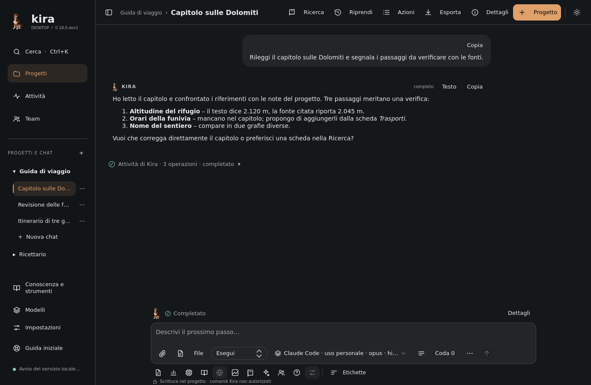
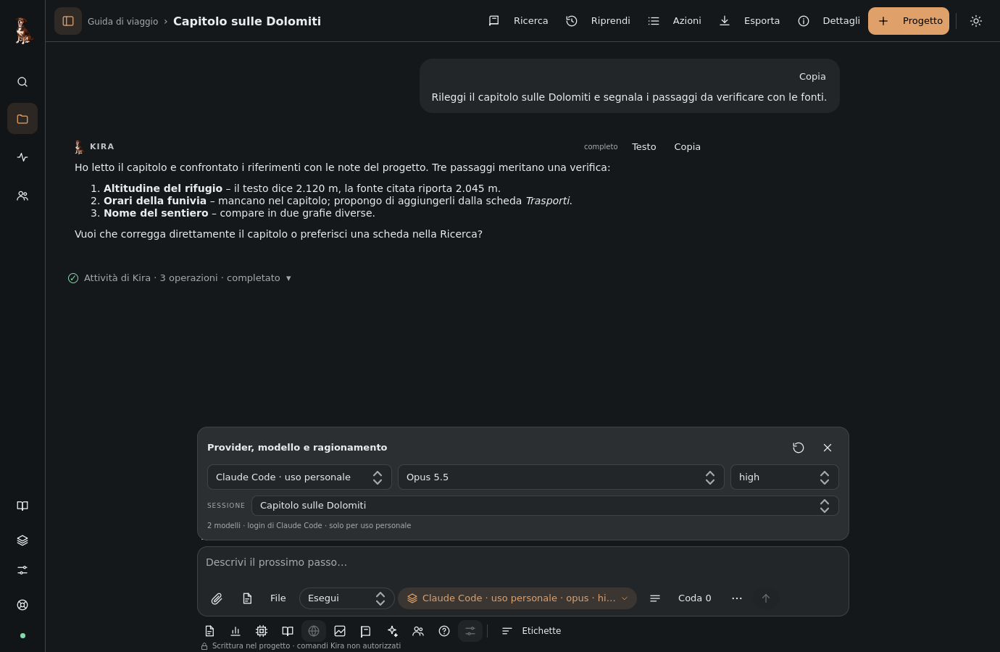
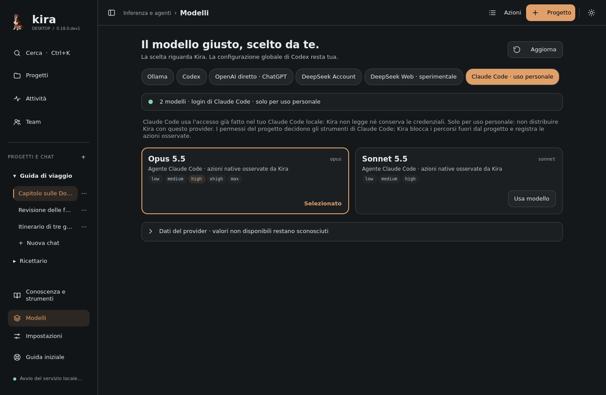

<p align="center">
  
</p>

<h1 align="center">Kira Desktop</h1>

<p align="center">
  Un harness desktop nativo che amplifica i modelli di IA che già usi.<br>
  Progetti, chat, strumenti, un browser isolato e agenti che collaborano — con i tuoi permessi, i tuoi dati, sulla tua macchina.
</p>

<p align="center">
  <a href="README.md">🇬🇧 Read in English</a> ·
  <a href="docs/USER_GUIDE_IT.md">Guida utente</a> ·
  <a href="docs/README.md">Documentazione</a> ·
  <a href="docs/STATUS.md">Stato</a> ·
  <a href="CHANGELOG.md">Novità</a>
</p>



## Che cos'è Kira

Kira non è un'altra finestra di chat. È un **harness**: uno spazio di lavoro
durevole che dà al modello un progetto, una memoria, strumenti ispezionabili e
confini chiari, perché il modello che scegli — locale o in cloud — possa fare di
più, in modo più sicuro, e tu possa sempre vedere che cosa è successo.

- **Il modello ragiona, Kira esegue.** Letture, scritture, comandi, pagine web e
  azioni nel browser passano da un servizio utente indipendente con il permesso
  che hai scelto per il progetto. Ogni operazione lascia una ricevuta nella chat.
- **Niente esce dalla tua macchina senza di te.** Progetti, chat, eventi delle
  esecuzioni, screenshot e allegati stanno in SQLite e in cartelle private del
  tuo profilo. Le credenziali restano nell'accesso ufficiale del provider: Kira
  non le legge e non le conserva.
- **Porta il tuo modello.** Ollama sul tuo computer, OpenAI Codex, un piano
  ChatGPT, DeepSeek o il tuo accesso a Claude Code: cambi provider nella stessa
  chat e conservi la conversazione.

## In evidenza

- **Progetti e chat con nome**, con istruzioni, memoria, provider e ragionamento
  per chat, bozze che sopravvivono ai riavvii, immagini allegate con anteprima.
- **Strumenti con ricevuta.** Lettura, ricerca, scrittura, comandi, ricerca web,
  navigazione: ogni chiamata mostra il riferimento letterale e l'esito registrato,
  espandibile fino ai dati originali.
- **Un browser isolato e il “Computer di Kira”.** L'agente naviga in un profilo
  separato accanto alla chat, scatta screenshot che vede davvero e ti restituisce
  il controllo per accessi e consensi.
- **Team di agenti** organizzati da te o da un coordinatore, con messaggi
  durevoli, pausa e ripresa, risultati consegnati nella chat di origine.
- **Registro di Ricerca.** Schede attribuite, collegamenti alle prove,
  valutazioni e proposte dell'agente che accetti o rifiuti: conoscenza che
  sopravvive alla chat.
- **Anima di Kira.** Identità di tua proprietà con una filosofia di lavoro,
  esperienza per ambito e apprendimento rivedibile.
- **Domande persistenti, obiettivi autonomi, indicazioni durante il lavoro** e
  riepiloghi pubblici del ragionamento dove il provider li offre.
- **Un'interfaccia silenziosa.** Una sola barra in alto, barra laterale a icone o
  nascosta, chip nel campo di scrittura, pannelli con schede, tema chiaro e
  scuro, italiano e inglese.

<p align="center">
  
  
</p>

## Provider

| Provider | Come si collega | Note |
| --- | --- | --- |
| **Ollama** | API HTTP locale (`http://127.0.0.1:11434` come predefinito) | Nessun download automatico. Strumenti verificati al primo uso; preset di contesto per chat. |
| **Codex** | OpenAI Codex App Server gestito, con l'accesso ufficiale | Strumenti nativi dell'agente, osservati e registrati da Kira. |
| **OpenAI diretto · ChatGPT** | Il tuo piano ChatGPT con l'accesso ufficiale | Ciclo degli strumenti di Kira, immagini in ingresso, contesto gestito automaticamente. |
| **DeepSeek Account** | Flusso account PKCE (sperimentale) | Adattatore Messages con il ciclo degli strumenti di Kira. |
| **DeepSeek Web** | Token di sessione verso l'endpoint web (sperimentale) | Strumenti mediati da Kira; limiti in [Backends](docs/BACKENDS.md). |
| **Claude Code · uso personale** | Il tuo Claude Code già autenticato tramite l'Agent SDK (extra opzionale) | Strumenti nativi osservati da Kira; browser, Computer, domande e Ricerca di Kira tramite un server MCP interno. Non incluso nei pacchetti; solo per il lavoro dell'utente autenticato. |

Il provider si sceglie per ogni chat in **Modelli**. [Backends](docs/BACKENDS.md)
descrive ogni collegamento, il suo stato di verifica e i limiti noti.

## Avvio rapido

Kira funziona su Ubuntu 24.04 (Python 3.12) e Ubuntu 26.04 (Python 3.14), in
modo nativo o in WSL2 con WSLg. Il desktop di riferimento è KDE Plasma/Wayland.

**Da un checkout** (consigliato finché la 0.18 è in sviluppo):

```sh
# 1. Installa uv (https://docs.astral.sh/uv/) e clona il repository
git clone https://github.com/antosec00/kira-desktop-app.git
cd kira-desktop-app

# 2. Installa le dipendenze bloccate (aggiungi l'extra Claude Code se lo vuoi)
uv sync --frozen                     # oppure: uv sync --frozen --extra claude-code

# 3. Avvia
uv run kira-desktop
```

Al primo avvio si apre la guida iniziale. Crea un progetto scegliendo una
cartella, seleziona provider e modello in **Modelli** e scrivi la prima
richiesta. La [guida utente](docs/USER_GUIDE_IT.md) spiega ogni pannello.

**Pacchetti nativi.** `python3 scripts/build_deb.py` costruisce il pacchetto per
Ubuntu 24.04 (`--target resolute` per la 26.04); `scripts/check_deb.py` lo
qualifica. [Piattaforme](docs/PLATFORM_TARGETS.md) e
[Operazioni](docs/OPERATIONS.md) coprono installazione, percorsi dei dati,
profili, backup e aggiornamenti. Tieni le build sperimentali su un `KIRA_HOME`
separato.

## Sicurezza e dati

- **I permessi sono per progetto:** sola lettura, scrittura nel progetto, host
  fidato (comandi come il tuo utente) o accesso completo. Nulla sale di livello
  in silenzio; [Control](docs/CONTROL.md) e [Full access](docs/FULL_ACCESS.md)
  definiscono il confine.
- **L'esecuzione è registrata.** Gli eventi durevoli stabiliscono che cosa è
  successo; la narrazione del modello non lo fa mai. Strumenti falliti o non
  confermati restano visibili.
- **Browser isolato.** Le pagine pubbliche sono dati non fidati, mai istruzioni.
  Accessi e consensi richiedono te; i profili sono isolati per chat salvo scelta
  esplicita.
- **Privato per impostazione.** Percorsi XDG o un `KIRA_HOME` esplicito, file
  0600, socket Unix privato fra interfaccia e servizio, nessuna telemetria.

[SECURITY.md](SECURITY.md) spiega come segnalare un problema.

## Documentazione

| Se vuoi… | Leggi |
| --- | --- |
| Usare Kira ogni giorno | [Guida utente](docs/USER_GUIDE_IT.md) |
| Installare, salvare, aggiornare, scegliere un profilo | [Operations](docs/OPERATIONS.md), [Profiles](docs/PROFILES.md), [Platform targets](docs/PLATFORM_TARGETS.md) |
| Collegare un provider | [Backends](docs/BACKENDS.md), [OpenAI direct](docs/OPENAI_DIRECT.md) |
| Capire che cosa è verificato e che cosa no | [Status](docs/STATUS.md) |
| Lavorare sul codice | [Developer guide](docs/DEVELOPER_GUIDE.md), [Architecture](docs/ARCHITECTURE.md), [Contracts](docs/CONTRACTS.md), [Build and customization](docs/BUILD_AND_CUSTOMIZATION.md) |
| Sfogliare tutti i contratti delle funzioni | [Indice della documentazione](docs/README.md) |

La documentazione tecnica è in inglese; la guida utente e le novità rivolte agli
utenti sono in italiano.

## Sviluppo

```sh
uv sync --frozen --extra claude-code
QT_QPA_PLATFORM=offscreen uv run pytest tests      # suite sintetica completa
uv run ruff check src tests scripts packaging
uv run mypy src
python3 scripts/check_translations.py
python3 scripts/check_public_tree.py
```

I test sintetici non sono prova del comportamento dei provider reali;
[Status](docs/STATUS.md) tiene separate le due cose. [CONTRIBUTING.md](CONTRIBUTING.md)
descrive rami, commit, lingue della documentazione e la lista di controllo.

## Stato del progetto

`main` contiene un'istantanea revisionata della versione corrente (0.15.1).
`dev/0.18` è la linea di sviluppo attiva: l'interfaccia 0.18, i provider Claude
Code e DeepSeek e le correzioni di robustezza per Ollama. Le versioni di sviluppo
sono marcate `.devN` e non vanno installate sopra un profilo utente attivo.

## Licenza

Kira Desktop è rilasciato con [licenza MIT](LICENSE). I componenti di terze
parti inclusi o collegati mantengono le proprie licenze; vedi
[Third-party notices](docs/THIRD_PARTY_NOTICES.md).
