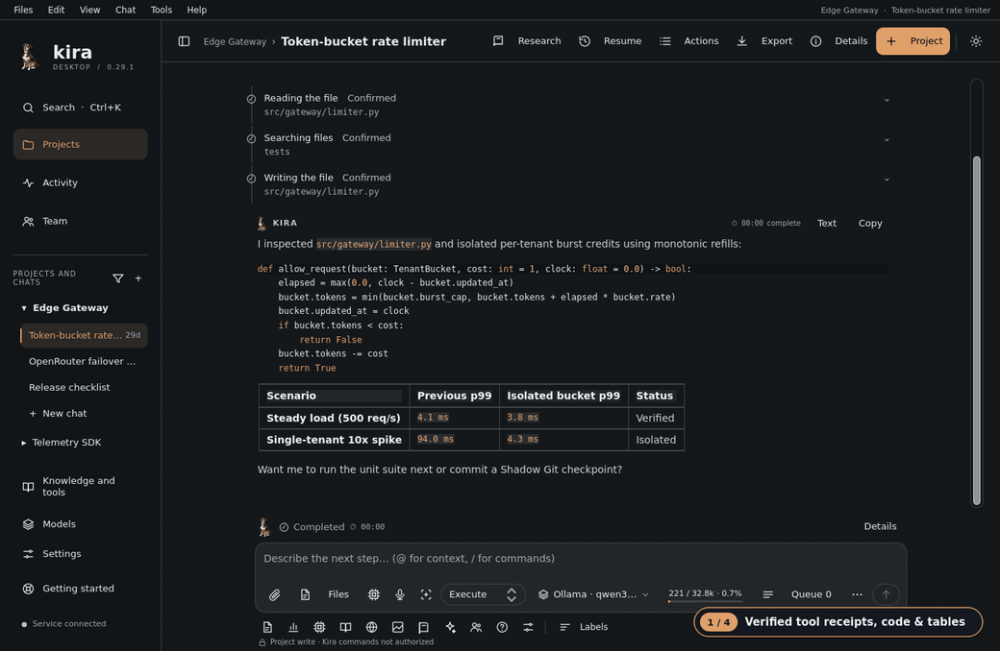
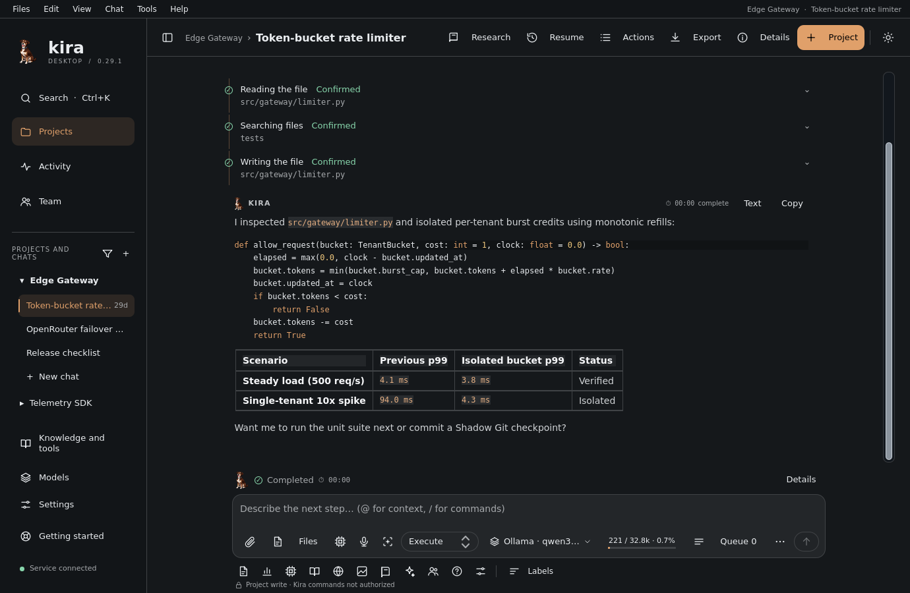
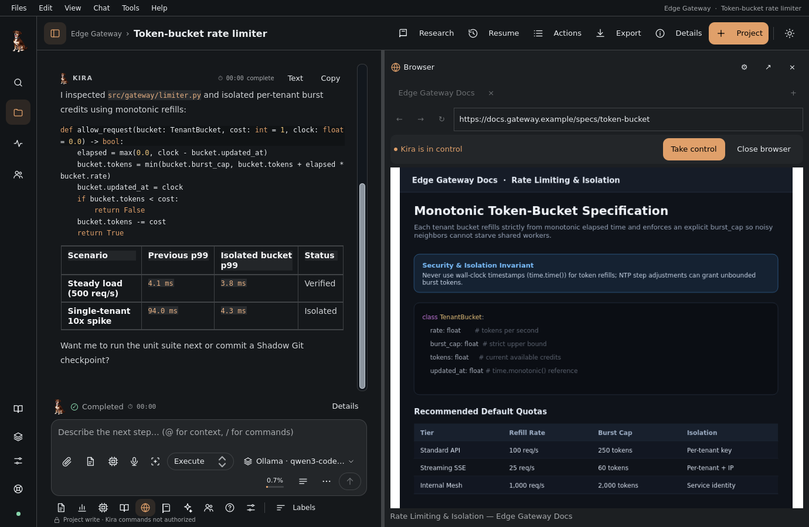
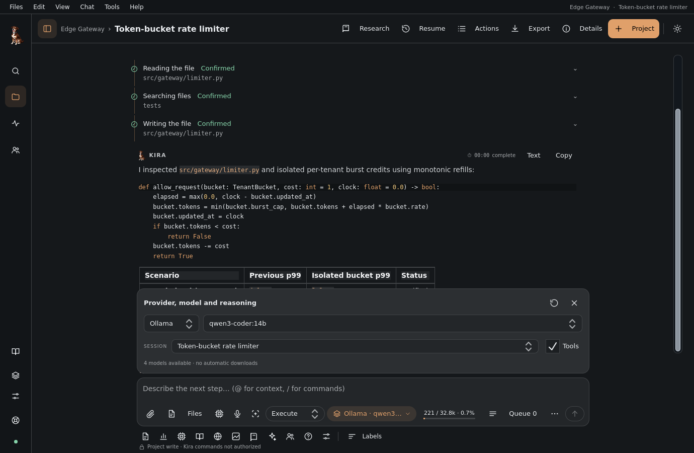
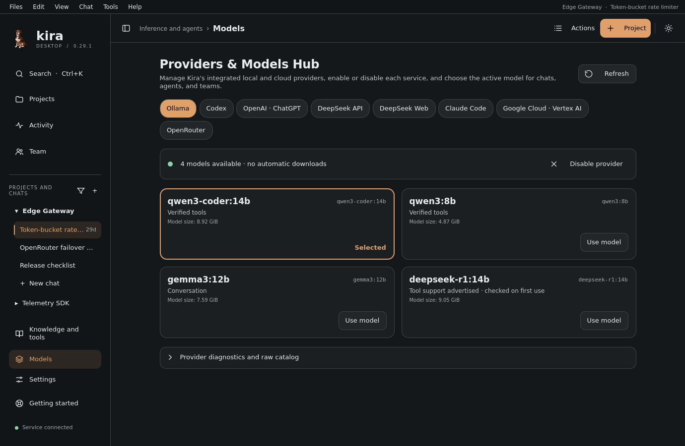

<p align="center">
  
</p>

<h1 align="center">Kira Desktop</h1>

<p align="center">
  The desktop application that amplifies the AI models you already use.<br>
  Projects, chats, tools, an isolated browser and agent teams — with your permissions, your data, on your computer.
</p>

<p align="center">
  <a href="README.it.md">🇮🇹 Leggi in italiano</a> ·
  <a href="docs/en/USER_GUIDE.md">User guide</a> ·
  <a href="docs/en/README.md">Documentation</a> ·
  <a href="docs/en/INSTALLATION.md">Installation</a>
</p>

<p align="center">
  <a href="https://github.com/antosec00/kira-desktop/releases/latest"></a>
  <a href="LICENSE"></a>
  <a href="docs/en/INSTALLATION.md"></a>
  <a href="docs/en/INSTALLATION.md#native-installation-on-windows-10-and-11"></a>
  <a href="#providers"></a>
</p>

<p align="center">
  
</p>

## What Kira is

Kira is not another chat window. It is a **durable workspace** that gives the
model a project, a memory, inspectable tools and clear boundaries, so that the
model you choose — local or in the cloud — can do more, more safely, and you can
always see what really happened.

- **The model reasons, Kira executes.** Reads, writes, commands, web pages and
  browser actions go through an independent local service with the permission
  you chose for the project. Every operation leaves a receipt in the chat: what
  the model narrates never counts as evidence.
- **Nothing leaves your computer without you.** Projects, chats, run events,
  screenshots and attachments live in a SQLite database and in private folders
  of your profile. Kira never reads cookies or other applications' credentials;
  the tokens and API keys of the sign-ins it manages (ChatGPT, Google Cloud,
  OpenRouter, DeepSeek) stay in private files of your profile (`0600`), outside the
  database, exports and diagnostics. The only external signal is an optional
  anonymous version count during update checks — a random local UUIDv4, the Kira
  version, the operating system (`windows`, `linux`, `wsl2`) and the install kind,
  inspectable directly in [`src/kira/ui/updates.py`](src/kira/ui/updates.py) and
  toggleable in **Settings → Local data → Updates** — with zero prompts, file paths
  or personal data.
- **Bring your own model.** Ollama on your computer, OpenAI Codex, your ChatGPT
  plan, Google Cloud · Vertex AI (with your GCP credits or balance and isolated
  multi-account switching), OpenRouter (300+ models with automatic context
  adaptation and `:free` model fallback), DeepSeek or your Claude Code: pick the
  provider per chat, enable or disable the services you use in **Models**, and
  switch providers without losing the conversation.

## Highlights

- **Named projects and chats**, with instructions, shared memory, provider and
  reasoning effort per chat, drafts that survive restarts, attached images with
  previews, universal `@Mentions` (`@file`, `@folder`, `@git`, `@terminal`,
  `@web`, `@soul`, `@team`) and contextual `/Slash Commands` in the composer.
- **Tools with receipts.** Read, search, write, commands, web search,
  navigation: every call shows the literal reference and the recorded outcome,
  expandable down to the original data.
- **An isolated browser and Kira's Computer.** The agent browses in a separate
  profile beside the chat, reads pages, takes screenshots it actually sees and
  hands control back to you for logins and consents.
- **Agent teams** organized by you or by a coordinator, with durable messages,
  pause and resume, and results delivered to the originating chat.
- **Research registry.** Attributed records, links to evidence, assessments and
  agent proposals you accept or reject: knowledge that outlives a single chat.
- **Kira's Soul.** Identities you own, with a working philosophy, explicit
  preferences, quick chat creation and configuration (`/anima crea`,
  `/anima preferenza`) and learned lessons you can review, keep per chat, per
  project or across all projects sharing the same Soul, or forget.
- **Universal Omnibox (`Ctrl+K`).** Instant cross-project search across
  projects, chats, messages, Soul identities and lessons, Research records,
  Canvas artifacts and native desktop actions, with zero token overhead.
- **Autonomous goals, persistent questions and guidance while working**, plus
  public reasoning summaries where the provider offers them.
- **A quiet interface.** One top bar, an icon rail or hidden sidebar, chips in
  the composer, tabbed side panels, light and dark themes, Italian and English.

<p align="center">
  
  
</p>
<p align="center">
  
  
</p>

## Providers

| Provider | How it connects | Who runs the tools |
| --- | --- | --- |
| **Ollama** | Local HTTP API (`http://127.0.0.1:11434` by default) | Kira; tools verified on first use, no automatic model downloads |
| **Codex** | OpenAI Codex App Server, with the official sign-in | Codex, with its sandboxes; Kira observes every operation and exposes its isolated browser, Computer and project tools via MCP |
| **OpenAI · ChatGPT** | Your ChatGPT plan, with the official sign-in | Kira; image input, hosted web search, automatically managed context |
| **Google Cloud · Vertex AI** | Isolated multi-account OAuth2 PKCE in Kira, read-only system `gcloud` ADC, or API Key | Kira; native Google models (`gemini-4-argon`, `gemini-3.8-flash`, `gemini-3.1-pro-preview`) and Vertex AI Partner Claude models, vision, and public reasoning summaries |
| **OpenRouter** | OpenRouter API key (`sk-or-v1-...` stored in your local `0600` profile or `OPENROUTER_API_KEY` env var) | Kira; dynamic catalog (`/api/v1/models`), automatic adaptation to context window, `max_tokens`, `reasoning`/`thinking`, prompt caching (Claude/Gemini), multimodal vision, and anti-stall fallback for `:free` models |
| **DeepSeek API** | DeepSeek account sign-in or DeeperSeeker proxy | Kira |
| **DeepSeek Web** | Session token from the website | Kira, with a text protocol for the tools |
| **Claude Code** | Your already signed-in Claude Code (optional extra, not in the packages) | Claude Code, observed by Kira; browser, Computer, questions and Research through an internal MCP server |

The provider is chosen per chat in **Models** (*Provider and Model Hub*), where you can also enable or disable each service to keep quick selectors clean. [Providers](docs/en/PROVIDERS.md)
describes every connection, its capabilities and known limits.


## Quick start

Kira runs **natively on Linux** (Ubuntu 24.04 LTS with Python 3.12 and Ubuntu
26.04 LTS with Python 3.14) and **natively on 64-bit Windows 10 and 11**, as
well as in WSL2 with WSLg.

**On Windows 10 / 11 (native):**

Download and run [`kira-desktop_windows_amd64_setup.exe`](https://github.com/antosec00/kira-desktop/releases/latest/download/kira-desktop_windows_amd64_setup.exe) from the [Releases](https://github.com/antosec00/kira-desktop/releases) page, or from PowerShell:

```powershell
Invoke-WebRequest -Uri "https://github.com/antosec00/kira-desktop/releases/latest/download/kira-desktop_windows_amd64_setup.exe" -OutFile "$env:TEMP\kira-desktop_setup.exe"
Start-Process -FilePath "$env:TEMP\kira-desktop_setup.exe" -Wait
```

The installer sets up Kira in `%LOCALAPPDATA%\Programs\Kira Desktop` without administrator privileges and creates **Kira Desktop** shortcuts on your Desktop and in the Start Menu ([Installation → Native installation on Windows 10 and 11](docs/en/INSTALLATION.md#native-installation-on-windows-10-and-11)).

**From the package on Linux (Ubuntu 24.04):**

```sh
cd "$(mktemp -d)"
wget https://github.com/antosec00/kira-desktop/releases/latest/download/kira-desktop_ubuntu24.04_amd64.deb
sudo apt install --no-remove ./kira-desktop_ubuntu24.04_amd64.deb
kira
```

For Ubuntu 26.04 use `kira-desktop_ubuntu26.04_amd64.deb`. Every version, with
the `SHA256SUMS` checksums and their `SHA256SUMS.sig` signature to verify the
files, is on the [Releases](https://github.com/antosec00/kira-desktop/releases)
page. Once installed, Kira looks for new versions on its own and installs them
when you ask, after verifying their signature
([Installation → Updating from Kira](docs/en/INSTALLATION.md#updating-from-kira)). If you prefer
to run Kira inside WSL2 on Windows, see
[Installation → On Windows with WSL](docs/en/INSTALLATION.md#on-windows-with-wsl).

**From source (Linux or Windows):**

```sh
# 1. Install uv (https://docs.astral.sh/uv/) and clone the repository
git clone https://github.com/antosec00/kira-desktop.git
cd kira-desktop

# 2. Install the locked dependencies (add the Claude Code extra if you want it)
uv sync --frozen                     # or: uv sync --frozen --extra claude-code

# 3. Start
uv run kira
```

On Linux from source you also need the system libraries listed in
[Installation → Running from source with `uv`](docs/en/INSTALLATION.md#running-from-source-with-uv);
the `.deb` package installs them on its own.

On first start the start screen offers **How Kira works**, which opens the
**Getting started** guide. Create a project by choosing a folder, select
provider and model in **Models** and write your first request. The
[user guide](docs/en/USER_GUIDE.md) explains every panel.

**Building the packages.** `python3 scripts/build_deb.py` builds the `.deb`
package for Ubuntu 24.04 (`--target resolute` for 26.04);
`python3 scripts/build_windows.py --package` builds the native Windows
installer (`dist/kira-desktop_<version>_windows_amd64_setup.exe`).
[Installation](docs/en/INSTALLATION.md) covers requirements, checksum
verification, data paths, separate profiles, backups and upgrades.

## Security and data

- **Permissions are per project:** read-only, project write, trusted host
  (commands as your user) or full access. Nothing is escalated silently.
  [Permissions and security](docs/en/PERMISSIONS_AND_SECURITY.md) defines the boundary.
- **Execution is recorded.** Durable events establish what happened; failed or
  unconfirmed tools stay visible.
- **Isolated browser.** Public pages are untrusted data, never instructions.
  Logins and consents require you; each chat has its own profile, temporary
  unless you choose to keep it. [Browser and Computer](docs/en/BROWSER_AND_COMPUTER.md).
- **Private by default.** XDG paths on Linux, `%LOCALAPPDATA%\Kira` on Windows,
  or an explicit `KIRA_HOME`, user-private files, and a private local IPC channel
  between interface and service.

[SECURITY.md](SECURITY.md) explains how to report a security issue.

## Documentation

| If you want to… | Read |
| --- | --- |
| Use Kira every day | [User guide](docs/en/USER_GUIDE.md) |
| Install, back up, upgrade, choose a profile | [Installation](docs/en/INSTALLATION.md) |
| Connect a provider | [Providers](docs/en/PROVIDERS.md) |
| Understand permissions and boundaries | [Permissions and security](docs/en/PERMISSIONS_AND_SECURITY.md) |
| Use the browser, Teams, Research, Soul | [Browser and Computer](docs/en/BROWSER_AND_COMPUTER.md), [Teams](docs/en/TEAMS.md), [Research](docs/en/RESEARCH.md), [Soul and Knowledge](docs/en/SOUL_AND_KNOWLEDGE.md) |
| Work on the code | [Development](docs/en/DEVELOPMENT.md), [Architecture](docs/en/ARCHITECTURE.md), [Contracts](docs/en/CONTRACTS.md) |
| Browse everything | [Documentation index](docs/en/README.md) · [Documentazione in italiano](docs/it/README.md) |

The documentation is written in Italian and translated into English in `docs/en/`.

## Development

```sh
uv sync --frozen --extra claude-code
QT_QPA_PLATFORM=offscreen uv run pytest tests      # complete synthetic suite
uv run ruff check src tests scripts packaging
uv run mypy src
python3 scripts/check_translations.py
python3 scripts/check_public_tree.py
```

[CONTRIBUTING.md](CONTRIBUTING.md) describes branches, commits,
documentation languages and the pull request checklist.

## License

Kira Desktop is released under the [MIT license](LICENSE). Bundled or linked
third-party components keep their own licenses; see
[Third-party licenses](docs/en/THIRD_PARTY_LICENSES.md).
