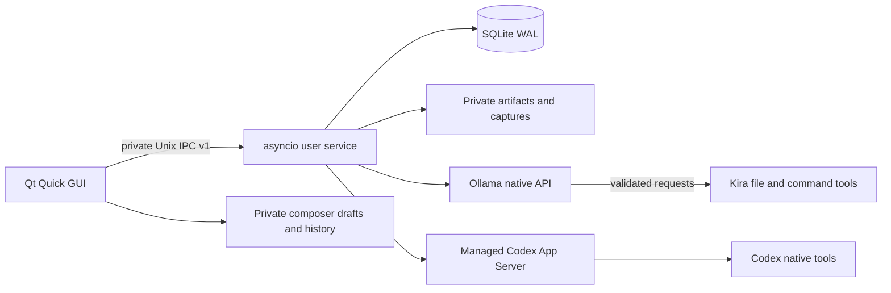

# Kira Desktop architecture

Kira Desktop combines a native Qt interface, an independent user service and
provider adapters. [Canonical contracts](CONTRACTS.md) define their interfaces;
[profiles](PROFILES.md) describes source and data ownership, and
[current qualification](STATUS.md) records verified runtime/package outcomes.

## Process boundaries

The GUI collects intent and displays state. The service owns execution and is
SQLite's only writer. It is an unprivileged user process, independent of the
window, started through a systemd user unit where appropriate or a detached
fallback. No system-wide service or linger is enabled. Ollama performs inference
with a small Kira-owned tool loop; Codex owns its native agent tool execution.
A Codex tool notification is observed once and never executed by Kira again.

## Durable ownership and recovery

Projects own directories, instructions, permission and memory. Ordinary sessions
are named chats owned by one project; each has its own backend reference and
history. Runs own sequenced events and actual tool/artifact evidence. A backend
change creates a new session; it does not transfer a native thread identifier.

`run.start` carries a durable request ID. The service validates permission and
active work, commits state/events before publication, and returns the same run
for an identical retry. Snapshots include cursors; replay and live subscription
are deduplicated by `(run_id,seq)`. One ordinary run is active per project.
Teams reserve overlapping roots and schedule readers concurrently while writers
remain exclusive until provider cleanup. See [team contracts](V03_TEAMS.md).

After service restart, unfinished work is interrupted rather than replayed.
Cancellation requested is distinct from confirmed cancellation. A provider's
successful outcome is not independent verification of every statement it made.
Chat displays messages/tools; Activity retains run lifecycle summaries.

The service also owns the durable prompt queue, chat archive/branch metadata,
objectives and native control identities. Queued requests keep their selected
session and mode, are editable only before dispatch, and use stable run request
identities. Confirmed completion advances the queue; failure/cancellation or
service restart pauses it. Pending native thread operations reserve overlapping
roots before provider effects. Their uncertain outcomes remain recorded and
cannot be retried by reusing the same identity.

Steering targets an exact active ordinary run. A committed intent precedes
provider dispatch; acknowledgment is distinct from model consumption. Accepted
guidance becomes a durable user message. UI polling and reconnect observe these
records rather than creating replacement work.

## Context and permissions

User-maintained instructions/memory are inspectable. Kira optionally adds bounded
excerpts from at most five other ordinary chats in the same project (6000 extra
characters maximum), with source references and unverified-claim labels. Ownership
joins exclude foreign projects, archived chats and team sessions. This does not remove already
supplied context from a persistent provider thread or constrain tool filesystem
permissions. The actual supplied block is retained as an event.

The service enforces permissions independently of the UI. Built-in file tools
validate contained paths and expected hashes. Arbitrary commands require trusted
host permission and act as the user; cwd is not a sandbox. Codex maps project
permissions to its supported native policy. External data cannot enlarge the
chosen policy. Global provider configuration/credentials remain untouched.

Plan, review and recap are per-run modes that narrow the effective execution
policy to read-only without changing stored project permissions. A plan does not
automatically execute, and a readable recap does not compact native context.
Compaction is a separate explicit provider operation requiring terminal evidence.
An active chat objective and a copied branch's bounded source text are supplied
as inspectable context; neither starts an automatic execution loop.

Project file discovery and Git preview run in bounded workers outside the
service event loop. File search excludes symlinks, sensitive defaults and ignored
paths. Git inspection disables external diff/text-conversion helpers and hooks,
does not apply edits, and bounds both subprocess output and serialized IPC size.

## Presentation and storage

Assistant Markdown is converted through a restricted GUI renderer. Tool/approval
content is literal; generated scripts, QML and raw HTML are not evaluated. Images
are not fetched by rendering. Explicit local document links are validated against
the current project. Compact tool previews and model/detail visibility do not
change durable content. Clipboard/file input inserts editable paths; imported
images are private PNGs, not new execution permissions.

| Default location | Content and owner |
| --- | --- |
| `~/.config/kira/ui.json` | Validated, atomically saved GUI preferences |
| `~/.config/kira/composer.json` | Private bounded GUI drafts and reusable sent-message history |
| `~/.local/share/kira/kira.sqlite3` | Projects, chats, events, teams, queue, goals and settings; service writer |
| `~/.local/share/kira/artifacts/` | Bounded captured output |
| `~/.local/share/kira/attachments/` | GUI-imported image files |
| `~/.local/share/kira/captures/` | Explicit native screenshots |
| `~/.local/share/kira/diagnostics/` | User-requested whitelisted diagnostics |
| `~/.local/share/kira/exports/` | Full private exports too large for an inline IPC response |
| `~/.local/state/kira/` | State and detached-service logs |
| `$XDG_RUNTIME_DIR/kira/service.sock` | Private IPC; state-directory fallback |
| User-selected project root | Actual project files, separate from application data |

Matching XDG variables override these defaults. `KIRA_HOME=/absolute/path`
groups `config`, `data`, `state` and `runtime` beneath one private directory; it
does not isolate project files, credentials or host permissions. These paths are
defaults relative to each user's home, not requirements for a particular account
or checkout. Profile selection and backup are documented in
[OPERATIONS](OPERATIONS.md).
Socket parent mode is 0700, socket 0600, with a single-writer process lock.

## Architectural decisions

- **Native Python/Qt:** Noble/Python 3.12 and separate Resolute/Python 3.14
  packages, both using pinned PySide6 Essentials/Qt 6.11.2. Bundled dynamically
  loaded dependencies avoid checkout/runtime pip dependencies in installed builds.
- **Service authority:** GUI closure does not own run cancellation. Provider
  protocols live below the UI. SQLite commits precede subscriber notifications.
- **Conservative WSLg rendering:** default software scene graph avoids observed
  EGL/Zink startup errors. Explicit renderer choices and native Linux defaults
  are preserved; inference GPU use is independent.
- **Cache identity:** packaged QML uses content-keyed cache selection so fixed
  reproducible timestamps cannot reuse incompatible cached UI. Explicit overrides
  win, and temporary environment changes end after first load.
- **Bounded, truthful evidence:** metadata, replay, IPC and output have explicit
  bounds; source/export data are distinguished from display previews. Unknown
  usage stays unknown, and secret redaction is not a universal guarantee.
- **Source and user-data ownership:** application source, tests and packaging
  belong in the repository. User profiles belong outside the source tree;
  existing attachment references must remain valid when a profile moves.
  Historical verification records keep their original hashes in private storage;
  [STATUS](STATUS.md) distinguishes those results from current public checks.

The application uses database schema 7 and IPC1. Migrations from older schemas
create a consistent backup before additive changes. Package scripts
never stop active work or remove user data. See [operations](OPERATIONS.md).

## Scope and verification

Kira Desktop offers project agents and explicit native actions. The
[control guide](CONTROL.md) describes how user actions, provider execution and
permission choices relate to each other.

Synthetic tests, installed-package checks, native GUI observations and live
provider turns are distinct evidence. Ollama configuration and real-model
qualification remain deferred unless separately recorded. Source compatibility
and historical results do not prove every host/runtime combination.

## Assistant integration (0.5)

The ordinary assistant has a service-owned Kira operating identity and an
inspectable runtime manifest. The selected provider remains explicit. User
project text and teammate reports stay data; they cannot alter the operating
contract or select another run identity through tool arguments.

Existing native Codex threads gain Kira tools through a temporary MCP bridge,
with a private descriptor and same-UID Unix relay bound to that RunContext.
Only the four registered Kira tools receive explicit per-thread tool approval;
other tools, sandbox and account settings keep their existing policies. The
relay has no general-purpose service RPC surface. Its installed bootstrap is
anchored to the trusted package location.

The service persists delegation intent, call result and origin event atomically.
After successful origin cleanup it hands project admission to the Team scheduler
before queued work can start. Team progress is coalesced and returned to the
origin transcript as service records. There is no implicit extra model turn.
Private mailbox recipients remain scoped across explicit continuations. Message
intent captures its target before dispatch, preventing a lost acknowledgment
from sending again to a different continuation team. Restart reconciles durable
state and requires explicit continuation for unfinished or uncertain work.

## Direct subscription provider decision

The `openai_chatgpt` backend uses a service-owned OAuth manager and Responses
HTTP/SSE transport, without Codex App Server. Credential files are private
configuration and must not enter project exports or public reports. Existing
session backend ownership remains intact. See [OpenAI direct](OPENAI_DIRECT.md)
for account binding, permissions, context and recovery boundaries.
