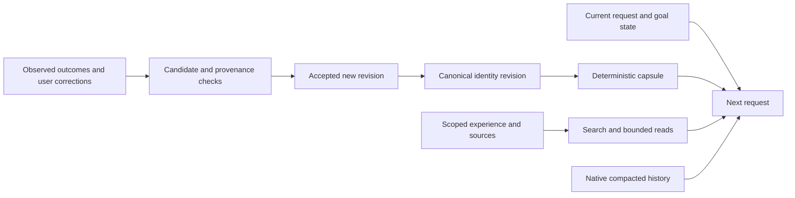

# Personalized Kira identities: design and offline prototype

Historical design and offline prototype. The subsequent 0.15.0 implementation
is governed by [KIRA_SOULS.md](KIRA_SOULS.md); STATUS records its qualification.
The scope described below remains the original design-phase record.

Original status: **proposal with an isolated lifecycle prototype**.
Desktop remains 0.14.1 / schema 13. No UI, provider integration, active profile,
application source, credentials, model settings or running work is changed.
The user selected design and a verifiable prototype as the scope of this phase.

The product name is **Anima di Kira**. An identity is a persistent, user-owned
collaboration profile with a working philosophy and scoped learned experience.
This does not imply consciousness, fine-tuning, independent feelings, or an
increase in a model's intrinsic capabilities. Better task performance is a
hypothesis to evaluate, not a property established by a persona prompt.

## Product concept

Allow several named Kiras, for example a methodical research collaborator and
an exploratory design collaborator. Each has its own authored core, accepted
preferences, experience library, learning settings and revision history.
They may use the same selected model; identity and model selection are separate.

The differentiating behavior is **traceable adaptation with reliable restoration**:
Kira can show what it learned, which original observation supports it, where it
applies, which version was used for a turn, and how to undo it. Personality,
historical experience and the current task remain separate types of information.

The proposed working philosophy describes desired results and judgment:

- Keep the requested result and evidence of completion explicit.
- Distinguish observations, interpretations and unresolved assumptions.
- Consider useful alternatives and tests proportionate to the uncertainty.
- Revise a conclusion when later evidence contradicts it.
- Seek available capabilities or an authorized alternative before declaring a blocker.
- Preserve useful decisions and next steps without replaying uncertain effects.

Some of these behaviors already exist in Kira's fixed identity and goal contract.
Do not duplicate them in every personalized profile. The user chooses emphasis
and collaboration style; the compiler emits only the additional preferences.
Avoid a mandatory thought ritual, endless self-critique, or instructions to
produce a private reasoning transcript. Save concise decisions and evidence,
not hidden chain of thought or public reasoning summaries as learning evidence.

OpenAI recommends simple, direct prompts and specific outcome criteria for
reasoning models; step-by-step thinking instructions can be unnecessary or
counterproductive. This informs the proposal, rather than certifying its effect
on every provider. [Reasoning best practices](https://developers.openai.com/api/docs/guides/reasoning-best-practices).

## Information layers and authority

| Layer | Owner and purpose | Delivery |
| --- | --- | --- |
| Kira operating identity | Application behavior and truthful capability discovery | Existing short fixed instructions |
| Personal core | User-authored philosophy, voice and collaboration defaults | Exact compact capsule every admitted turn and required request boundary |
| Accepted preferences | Explicit corrections, with original event provenance | Small structured overrides in the capsule |
| Experience library | Scoped lessons with applicability, sources and uncertainty | Search metadata, then bounded reads when relevant |
| Current work | Latest request, goal, corrections, progress, evidence and unresolved work | Existing independent task/goal anchors |
| Capability facts | Actual provider/tool transport and permission state | Existing service-owned capability discovery |

Editable content must not enter `RunContext.assistant_instructions`: Codex maps
that field to developer instructions and Ollama to a system message. A user
profile is a clearly labeled user-level default. Specific current user/chat/
project instructions take precedence; the latest capsule supersedes earlier
profile revisions. It cannot modify OS permissions, tool access, model, effort,
goal activation, evidence outcomes or completion status.

Free-form prose can still be ambiguous or contain contradictory instructions.
The compiler does not claim semantic enforcement: the editor must surface
conflicting structured preferences, show the exact compiled preview, and permit
correction. Execution boundaries remain service-enforced independently.

## Context compilation and cost

Compile deterministically from canonical saved records. Reading, saving and
activating a profile requires no provider call. Stable content should remain
byte-identical across unchanged requests, without timestamps or random text.
Versions and provenance metadata belong primarily in the service receipt, not
in an ever-growing prompt appendix.

An initial design target is approximately 150–250 additional tokens for a
typical short profile. **This is not a universal cap or a measured result.** The
prototype reports exact UTF-8 bytes and unknown tokens; it never calls byte counts
token counts. Its separate limits are a 1,200-byte authored core and a 3,072-byte
essential capsule. Oversized essentials fail visibly, without silent truncation.
These are experimental content bounds, not reasoning/output limits.

The production editor should offer a short always-present core and a larger
reference library, with explicit user choice of what belongs in each. It must
not move essential constraints into optional retrieval without telling the user.
Extended memories consume context when read; a large archive does not imply
unlimited usable context or perfect recall. For a small-window provider, show
the measured/estimated overhead and offer a smaller profile instead of quietly
reducing reasoning effort or dropping task constraints.

Reuse Kira's bounded `kira.help_search` / `kira.help_read` infrastructure. Add a
run-owned identity scope with revision-qualified references and original-source
reads. The initial prototype uses Unicode lexical matching and a bounded user
feedback tie-breaker. It does not claim semantic search or guaranteed recall.
The production capsule should include compact relevant topic cues and retrieval
availability; the prototype includes only a scoped memory count and lookup hint.
Tool-disabled models receive all essentials, with no claim they can read extras.

Stable prompt prefixes can help caching; changing or compacting history can
reduce reuse. Actual cache benefit must be measured with Kira's adapters, and
cached input still occupies context. [Prompt caching](https://developers.openai.com/api/docs/guides/prompt-caching).

## Evolution without drift

Three proposed modes:

1. **Manual**: only user edits; no learned proposals.
2. **Suggest** (default): collect bounded candidate lessons/preferences; activate
   through a nonmodal review surface, not an approval dialog for every click.
3. **Adaptive** (opt-in): automatically apply narrow, explicitly expressed user
   preferences; retain an undoable change history. Inferred lessons remain
   suggestions until accepted. Useful-feedback ranking can adapt independently.

The first implementation should not infer global preferences from silence,
assistant self-praise, every successful tool call, or repeated copies of one
summary. A completed command proves that command's recorded outcome, not that
an interpretation is generally correct. A practical lesson needs an applicability
condition, a source, an interpretation label, and a reason to recall it.

Example: an observed stale browser target can support a project-scoped suggestion
to refresh the observation before retrying a comparable action. It does not
justify a global claim that a browser is broken or permissions should be bypassed.

Proposed record:

```text
identity_id, memory_id, revision, type, scope, applicability,
statement, source_event_refs, original_event_order,
status, supersedes, user_decision, last_confirmation
```

Original event identity/order comes from the service, never from model arguments.
The source reader preserves original bytes and provenance within the permitted
scope. Web pages, tool text and model summaries cannot promote themselves into
user preferences. A model may propose an interpretation of an allowed source;
the service controls classification, scope and acceptance. Source links establish
traceability, not semantic proof.

The offline prototype deliberately has no natural-language classifier. A trusted
fixture supplies an already structured user preference and service observation.
Recognizing explicit user requests in real chat, detecting semantic conflicts,
and proposing generalizable lessons require a separately evaluated integration.
If that uses the selected model, maintenance cost and latency must be visible;
there is no automatic second model or hidden per-message reflection request.

Prefer milestone/correction-triggered collection with deduplication and batching.
Reading a memory never increases its credibility. Feedback affects retrieval
ranking, not factual truth. Contradictory or failed lessons can be superseded or
retired, without rewriting their original evidence. Expiry/revalidation policies
must not silently erase explicit user preferences.

## Version, rollback and concurrency semantics

- Every accepted change creates an immutable revision in an atomic transaction.
  Compare-and-swap revision checks prevent concurrent stale edits.
- A turn receives a frozen revision and capsule hash. Mid-turn edits do not
  rewrite an inference already in flight; the next admitted turn/cycle adopts
  the authorized current revision.
- Preference precedence follows original event order, not proposal acceptance
  or delivery order. A delayed older correction cannot overwrite a newer one.
- Durable source-event uniqueness prevents delivery retries from reinforcing a
  memory twice. A conflicting reuse is an error.
- Rollback creates a new revision of the selected old content. It does not rewind
  the event ledger. Pending old learning is invalidated and a learning watermark
  rejects delayed pre-rollback proposals/feedback. Production must use the
  authoritative current service event cursor, including not-yet-indexed events.
- Matching already-recorded feedback receipts remain no-ops after rollback;
  they cannot restore reverted weights. New feedback needs a fresh user event.
- Disabling a profile emits a current disabled marker; stale references require
  fresh discovery. No background reactivation occurs on restart.

The prototype's SQLite file is explicitly selected, marked as experimental,
and rejected if it is an unrelated database. It does not migrate an app profile.
Its methods assume a trusted fixture process, not a production authentication
boundary. Sources can omit an event reference/order only to create fresh fixture
events; production ingestion must require both service-owned fields.

## Compaction, provider changes and identity separation



After compaction, reconstruct the current capsule from canonical storage. Never
ask the historical summary to remember which identity is current. Preserve the
provider's opaque state unchanged, keep complete tool-call/result groups, and
supply current task anchors independently. A reference in memory is not a command
to replay a past action.

Kira's direct `_wire` already reinjects supplied context outside its saved native
items. Integration must verify the exact placement and precedence on each adapter,
including tool-loop requests, manual maintenance, structured fallback, provider
switches and tool-disabled models. Manual compaction must not learn or reactivate
historical personality. Provider-private reasoning remains opaque.

OpenAI's memory/compaction example distinguishes continuity within a run from
workflow lessons for later runs; generated memory is not the investigation's
source of truth. This is compatible with keeping Kira's identity and evidence
separate. [Memory and compaction](https://developers.openai.com/cookbook/examples/agents_sdk/building_reliable_agents_memory_compaction).

Two separate product operations are necessary:

- **Another Kira in a new chat**: separate identity-owned memory, fresh native
  state and explicit project sharing. No automatic transfer of private biography,
  chat excerpts or learned lessons.
- **Switch Kira in this chat**: change future defaults while the user deliberately
  retains task conversation. This is not a promise to erase what was already read.
  Start a fresh native generation and construct a reviewed portable handoff when
  isolation from the old opaque state is required. Never resume a stale stored
  generation merely because the user returns to an earlier identity/provider.

The prototype's checkpoint key contains session, identity, identity epoch,
provider, model, account and provider generation. It rejects cross-boundary
reuse, including A-to-B-to-A transitions. It does not implement native adapter
reset, portable handoff, or provider-side deletion. An in-flight turn still owns
its admitted snapshot, including source access; rollback is not retroactive erasure.

## Integration map for a later implementation

| Existing area | Proposed change / required qualification |
| --- | --- |
| `service/server.py` ordinary-run context assembly | Resolve immutable identity binding and add user-level capsule; do not alter fixed operating authority |
| `service/knowledge.py` | Add scoped identity sources/read paging; reuse existing ownership and provenance checks |
| `service/direct_context_service.py` / `backends/direct_context.py` | Reinjection on native/fallback/manual boundaries; keep opaque state and paired tools intact |
| `backends/codex.py`, `backends/ollama.py` | Validate actual wire placement, disabled-tool fallback and native-history separation |
| `service/autonomous_goals.py` | Keep identity binding separate from frozen `session.settings`; next-cycle adoption must not trigger false provider/settings conflicts |
| `service/teams.py` | Share only explicitly selected collaboration rules in assignments; no ordinary-chat memory inheritance |
| Service storage | Add versioned identities, bindings, learning receipts and run snapshots through an additive backed-up migration |
| Settings / Knowledge UI | Profile selector, editor, compiled preview, memory sources, learning mode, history and undo |

No schema number is reserved by this proposal. Production storage should use
normalized immutable records/deltas rather than copying a whole large memory
archive on every feedback event. The small prototype snapshots entire documents
for clarity and caps accepted lessons at 128; this is not the proposed long-term
archive architecture. Use indexes and bounded queries, not loading every persona
and source into each model request. No default cross-persona/global lesson sharing.

UI proposal: **Le mie Kira**, then **Identità**, **Come lavora**, **Cosa ha
imparato**, **Evoluzione**. A compact active-profile label belongs beside the chat
controls. “Perché lo ricordi?” opens the original source and applicability;
“Ripristina” previews the version diff. Learning notifications should be batched
and nonmodal. Export/import is explicit, excludes private experience by default,
and shows exactly what will transfer. None of these UI elements is implemented.

Deletion needs a separate production contract: remove current selection and
retrieval access; decide how local audit records, exports and backups are retained
or erased. Do not promise removal from already delivered provider context.
Rebinding/migration/restart must preserve drafts, chats, paused objectives and
browser sessions under the existing idle/backup contract.

## Executable experiment and qualification

Only these development modules implement this experiment:

- `scripts/prototypes/kira_soul.py`: deterministic compilation, SQLite revisions,
  original source ledger, learning proposals, scoped retrieval and harness envelope.
- `scripts/prototypes/test_kira_soul.py`: synthetic behavioral checks.
- `scripts/prototypes/demo_kira_soul.py`: two fictional identities and a disposable
  end-to-end lifecycle demonstration, printing a JSON report.

Run from the checkout with Python 3.12+; no installation or dependencies:

```sh
python3 -m unittest discover -s scripts/prototypes -p 'test_kira_soul.py' -v
python3 scripts/prototypes/demo_kira_soul.py
```

Each run uses temporary SQLite databases and deletes them afterward. No application
imports, providers, network, account quotas, active profile, real conversations,
environment credentials or research checkout are used. `KIRA_HOME` is not consulted.
`build/kira-souls-prototype/` contains ignored local verification output.

Test scenarios cover immutable active snapshots, next-turn changes, two identities,
project boundaries, source reads, original-event order and duplicate delivery,
delayed corrections, rollback and feedback replay, concurrent edit rejection,
disabled profiles/tools, restart, provider/account/model transitions, exact byte
bounds and **100 synthetic checkpoint replacements**. These replacements are
opaque strings, not real provider compactions. Matching a capsule across them
proves reconstruction, not comprehension, semantic recall, or improved reasoning.

Before production, evaluate the selected models with paired baseline/profile
tasks: factual correction, conflicting instructions, long multi-tool work,
tool-unavailable recovery, objective continuation, provider switching, native
compaction and unrelated-project isolation. Preserve the configured effort and
use identical task inputs; repeat enough trials to show variation. Measure task
success, unsupported claims, missed corrections, unnecessary actions, tokens,
latency and memory precision/recall. Do not use verbosity, self-reported confidence
or a single successful demonstration as a proxy for intelligence.

Release gates include real service/IPC/QML tests, ownership/admission tests,
migrations/backup/restore, exports/deletion, tool-boundary continuity, Team
permissions, all supported provider adapters and controlled live evaluations.
Those gates are outstanding. Current experimental results belong in STATUS and
must never be described as qualification of an installed feature.
