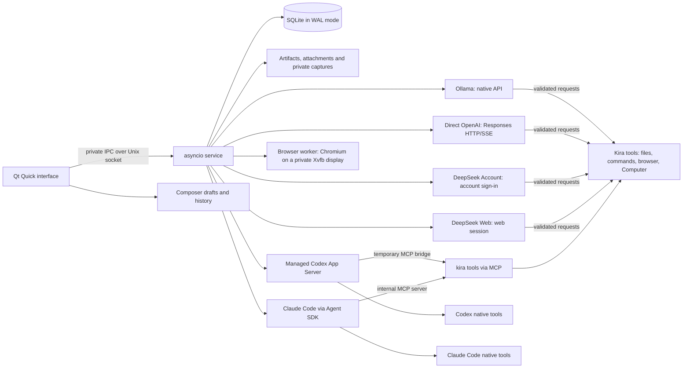

# Kira Desktop architecture

*[Leggi in italiano](../it/ARCHITETTURA.md)*

This page explains how Kira is built beneath the interface: which processes
exist, who owns the data, what happens after a restart and why some choices
were made the way they were. It is aimed at people who want to understand how
Kira works or contribute to the code; the details of IPC methods, events and
permissions are in the [Contracts](CONTRACTS.md) reference.

## Process boundaries

Kira consists of a native Qt interface, an independent user service and one
adapter per provider, all running in the user's session.

The interface collects the user's intentions and shows state. The service owns
execution and is the **only process that writes to the SQLite database**. It is
an unprivileged user process, independent of the window, started by a systemd
user unit where available and otherwise as a detached process; there is no
system service and no active "linger".

Providers fall into two families:

- **Ollama, Direct OpenAI, DeepSeek Account and DeepSeek Web** perform inference
  while Kira runs a small tool loop of its own: the model asks for a tool, the
  service validates the request, executes it and returns the result. Direct
  OpenAI uses an OAuth manager in the service and a Responses HTTP/SSE transport
  without going through Codex App Server; DeepSeek Account uses the sign-in with
  your DeepSeek account (or a DeeperSeeker instance with an API key); DeepSeek
  Web reuses a web session and solves the proof-of-work challenge with a
  WebAssembly module executed in wasmtime. Credential files are private
  configuration and never enter exports.
- **Codex and Claude Code** own their native tools. Kira observes their
  notifications (exactly once: an observed notification is never re-executed by
  Kira) and additionally offers its own `kira` tools through MCP.

The isolated browser runs in a **separate worker**: a Chromium with a graphical
interface on a private Xvfb display, owned by the service. Neither the interface
nor the providers talk to Chromium directly; every action goes through the
service.

## Durable ownership and recovery

The data model follows a simple hierarchy:

- A **project** owns its folder, instructions, permission and memory.
- A **chat** (ordinary session) has a name, belongs to exactly one project and
  keeps its own provider reference and its own history. Switching provider
  within the same chat retires the current provider generation and opens a new
  one without a native reference: a native thread identifier is never
  transferred from one provider to another.
- A **run** owns the sequenced events and the real proof of tools and
  artifacts.

`run.start` carries a durable request identifier. The service checks permission
and active work, saves state and events **before** publishing them to
subscribers and, if it receives the same request again, returns the same run
instead of creating another one. Snapshots include cursors; replay and live
subscription are deduplicated by the `(run_id, seq)` pair.

An admission rule applies: **only one active ordinary run per project**. Teams
reserve overlapping roots: readers are scheduled in parallel, writers stay
exclusive until the provider has completed cleanup.

After a service restart, unfinished work is **interrupted, not repeated**. A
cleanup that recorded no process identity cannot be verified within the same
boot: it stays pending until the computer restarts, and the next start then
releases it. A requested cancellation is distinct from a confirmed cancellation,
and the interface shows them differently. A successful outcome reported by the
provider is not an independent verification of every claim the model makes: the
chat shows messages and tool receipts, the Activity section keeps the lifecycle
summary of every run.

The service also owns the request queue, the archive and branching metadata of
chats, the goals and the identities of native actions. Queued requests keep the
chosen session and mode, can be edited only before dispatch and use stable
identities: a confirmed completion advances the queue; an error, a cancellation
or a service restart pauses it. An uncertain outcome of a native operation
stays recorded and cannot be retried by reusing the same identity.

**Guidance** (**Send guidance**) targets one specific active ordinary run. The
intention is saved before dispatch to the provider; acceptance is distinct from
consumption by the model, and accepted guidance becomes a durable user message.
Polling and reconnection of the interface read these records; they do not
create replacement work.

## Context and permissions

The instructions and memory maintained by the user are inspectable. Unless the
project disables it (`share_session_summaries:false`), Kira adds limited
excerpts from at most five other ordinary chats of the same project (6000
additional characters in total), with the source reference and the
unverified-claim label; it excludes external projects, archived chats, Team
sessions and chats with another Soul identity. The block provided to the model
stays recorded as an event. This context does not remove what a persistent
provider thread has already received and does not limit the tools' file system
permissions.

The service enforces permissions **independently of the interface**:

- The built-in file tools validate that paths stay inside the project (outside
  it only with **Full access**) and check the expected hashes before modifying a
  file.
- Arbitrary commands (an `argv` vector, no shell) require the **Trusted host**
  or **Full access** permission and act as the user: the working folder is not
  a sandbox.
- Codex receives a mapping of the project permission onto its own native
  policy. External data (project text, web pages, replies from other agents)
  cannot widen the chosen policy; global configuration and provider credentials
  are not touched.

The **Plan**, **Review** and **Recap** modes are properties of a single run:
they narrow the effective policy to read-only without changing the project's
saved permission. A plan is not executed automatically and a readable recap
does not compact the native context: compaction is a separate, explicit
provider operation. A chat's active goal and the limited source text of a
copied branch are inspectable context; neither starts an automatic loop.

Project file search and the Git preview run in **bounded workers** outside the
service's event loop. Search excludes symbolic links, sensitive paths by
default and ignored paths. Git inspection disables external diff and conversion
helpers and hooks, applies no changes and limits both the subprocess output and
the size of the IPC response.

## Presentation and storage

The assistant's Markdown goes through a **restricted renderer** in the
interface. Tool and approval content is literal; generated scripts, QML and raw
HTML are never evaluated and rendering does not download images. Explicit links
to local documents are validated against the current project. Compact tool
previews do not change durable content. Pasting from the clipboard or from a
file produces editable paths; imported images are private PNGs and grant no new
execution permissions.

| Default location | Content and owner |
| --- | --- |
| `~/.config/kira/ui.json` | Interface preferences, validated and saved atomically (GUI) |
| `~/.config/kira/composer.json` | Bounded drafts, history of sent messages and pending identities of chat requests (GUI) |
| `~/.local/share/kira/kira.sqlite3` | Projects, chats, events, Teams, queue, goals and settings (only the service writes) |
| `~/.local/share/kira/artifacts/` | Captured output, with size limits (service) |
| `~/.local/share/kira/attachments/` | Images imported from the interface |
| `~/.local/share/kira/image-attachments/` | Images attached to requests (service) |
| `~/.local/share/kira/captures/` | Explicitly requested native screenshots |
| `~/.local/share/kira/diagnostics/` | Diagnostics requested by the user, with field filtering |
| `~/.local/share/kira/exports/` | Private exports too large for an IPC response |
| `~/.local/share/kira/browser-engine/`, `browser-profiles/`, `browser-temporary/` | Downloaded Chromium and isolated browser profiles (service) |
| `~/.local/state/kira/` | State and logs of the detached service |
| `~/.local/state/kira/souls-ui/`, `research-ui/`, `knowledge-ui/` | Drafts and pending identities of Soul, Research and project tools (GUI) |
| `$XDG_RUNTIME_DIR/kira/service.sock` | Private IPC socket; falls back to the state folder when unavailable |
| Project folder chosen by the user | The real project files, separate from the application data |

The corresponding XDG variables override these values. `KIRA_HOME=/absolute/path`
groups `config/`, `data/`, `state/` and `runtime/` under a single private
folder; it does not isolate project files, credentials or host permissions. The
socket folder has mode `0700` and the socket `0600`, with a single-writer
process lock. Profiles and backups: [Installation](INSTALLATION.md).

## Architectural decisions

- **Native Python and Qt.** One package for Ubuntu 24.04 (Python 3.12) and a
  separate one for Ubuntu 26.04 (Python 3.14), both with PySide6 Essentials / Qt
  6.11.2 at a pinned version. Dependencies are included in the package and
  loaded dynamically: an installation depends neither on a checkout nor on
  `pip`.
- **Service authority.** Closing the window does not cancel a run; provider
  protocols live beneath the interface; the SQLite commit always precedes the
  notification to subscribers.
- **Cautious rendering on WSLg.** The software scene graph is the default to
  avoid EGL/Zink startup errors observed on WSLg; an explicit renderer choice
  and native Linux defaults are respected. GPU use for inference is independent.
- **QML cache identity.** Packaged QML selects the cache with a content key, so
  the package's reproducible timestamps do not reuse an incompatible cache;
  explicit overrides win and temporary environment variables end after the
  first load.
- **Bounded, truthful proof.** Metadata, replay, IPC and output have explicit
  limits; source and export data are distinct from previews. Unknown usage
  stays unknown and secret redaction is not a universal guarantee.
- **Source and data kept separate.** Source, tests and packaging live in the
  repository; user profiles live outside the source tree, and attachment
  references stay valid when a profile is moved.
- **Database upgrade.** A newer version upgrades the database automatically
  after a consistent backup; an older one does not open a newer database.
  Package scripts neither stop active work nor remove user data.

## Assistant integration

The ordinary assistant has an **operational identity** owned by the service and
an inspectable runtime manifest. The chosen provider stays explicit. Project
text and reports from Team mates are data: they cannot alter the operational
contract or select another execution identity through a tool's arguments.

Codex native threads receive the `kira` tools (and, with an autonomous goal,
the goal tools) through a **temporary MCP bridge**: a private descriptor and a
same-user Unix socket relay, bound to that `RunContext`. Only the registered
Kira tools receive the explicit per-thread approval; the other tools, the
sandbox and the account settings keep their policies. The relay exposes no
generic RPC surface towards the service and its installed bootstrap is anchored
to the package's trusted location. Claude Code receives Kira's tools from an
**internal MCP server** started by the adapter inside the service process, with
the names `mcp__kira__<tool>` visible in the receipts.

When the assistant delegates work to a Team, the service atomically saves the
delegation intent, the call result and the originating event, and hands the
project's admission to the Team scheduler only after the originating turn has
closed and been cleaned up. Team progress is grouped and reported in the
originating transcript as service records, without an implicit extra model
turn. A message's intent captures the recipient before dispatch, so a lost
acceptance cannot resend it to a different Team. On restart the service
reconciles durable state and requires an explicit continuation for unfinished
or uncertain work.

## Browser and Computer as a service actor

The isolated browser and **Kira's Computer** are a single actor owned by the
service (`service/web.py`), which coordinates the Chromium worker and the
worker that observes and acts on the screen. Every model tool (`browser.search`,
`browser.navigate`, `computer.observe`, `computer.act`…) goes through the
service, which checks the project permission, the mode and the chat's consent,
records the action as an event and returns a bounded result to the model.
Consent can be revoked while the browser is open; a request awaiting approval
keeps its identity. The handover of control between the user and Kira (**Take
control**, **Return to Kira**) is also service state, not interface state.
Usage details and limits are in
[Browser and Computer](BROWSER_AND_COMPUTER.md).
