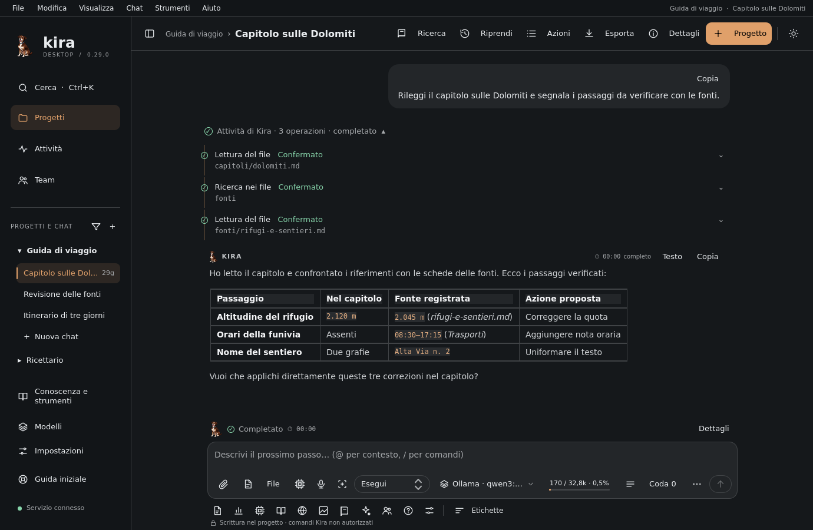
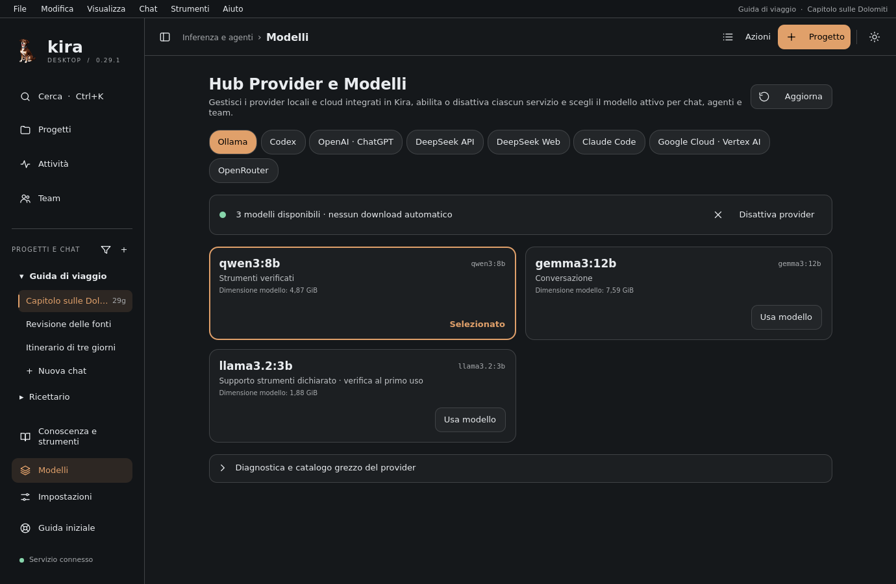
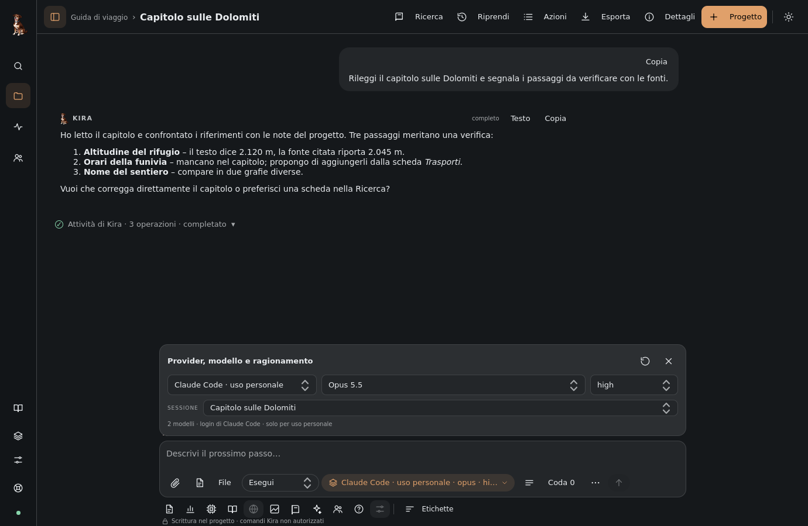

# Kira Desktop user guide

*[Leggi in italiano](../it/GUIDA_UTENTE.md)*

Kira Desktop is a native application for working with a language model on your
projects: reading and editing files, running commands, consulting the web,
coordinating a team of agents and keeping memory and results on your computer.
This guide explains how it is organized, how it is used day to day and what its
real limits are. The linked topic guides go deeper into each subject.

## Table of contents

1. [What Kira is and how it is organized](#what-kira-is-and-how-it-is-organized)
2. [First steps](#first-steps)
3. [The interface](#the-interface)
4. [Writing requests](#writing-requests)
5. [Reading results](#reading-results)
6. [Managing chats](#managing-chats)
7. [Context and memory](#context-and-memory)
8. [Providers at a glance](#providers-at-a-glance)
9. [Integrated browser and Kira's Computer](#integrated-browser-and-kiras-computer)
10. [Agent teams](#agent-teams)
11. [Project research](#project-research)
12. [Kira's Soul and Knowledge and tools](#kiras-soul-and-knowledge-and-tools)
13. [Workspace and native actions](#workspace-and-native-actions)
14. [Settings](#settings)
15. [Closing, restarting, data and backups](#closing-restarting-data-and-backups)
16. [Keyboard shortcuts](#keyboard-shortcuts)
17. [Frequently asked questions and common problems](#frequently-asked-questions-and-common-problems)

## What Kira is and how it is organized

### Projects, chats and the local service

Kira organizes work into **projects**. A project is a folder on your computer
with a name, optional instructions and a permission level. Inside a project you
open one or more **chats**: each chat has its own conversation, its own draft,
its own tools and results. In the sidebar you first choose the project and then
the chat; each chat shows only its own history.

Behind the window runs a **local service**, a separate process that executes
requests, talks to the providers, records every operation and keeps the history
in a database on your computer. The window is only a view onto that service:
you can close and reopen it while the work continues, and the colored dot at
the bottom of the sidebar tells you whether the window is connected to the
service. The service runs one autonomous job at a time for each project.

### The model reasons, Kira executes

The model (the one you choose among the connected **providers**: Ollama, Codex,
OpenAI direct, DeepSeek, Claude Code) decides what to do and writes the
responses. Kira provides the tools — reading and writing files, commands,
browser, memory, teams — and runs them within the permissions you gave the
project. The model used to build Kira does not dictate which model you must use
inside the app: the choice is yours, for every chat.

### Tool receipts are the proof of what happened

Every operation Kira performs leaves a **receipt**: a row in the conversation
with the name of the operation, the path or the command, the outcome recorded
by the service and the original data. Receipts are the source to consult to
know what was really done. Text from the model saying "I ran the command" is a
narrative: it must be compared with the receipts. In the same way, the
**Completed** status of a request confirms that the turn has ended, not that
the result is correct: for that there remain responses, receipts, artifacts and
your own verification.



## First steps

### Starting Kira

If you installed the package, open **Kira Desktop** from the applications menu
or run from any folder:

```sh
kira-desktop
```

`kira-desktop --version` prints the installed version. In WSL a working
graphical session is required, for example WSLg.

To start from the source code, open a terminal in the root of the repository
(where `pyproject.toml` is):

```sh
uv sync --frozen
uv run kira-desktop
```

This mode requires `uv` and a supported Python environment. The folder you
launch the command from does not automatically become a project: you choose it
in the interface. Requirements, packages, profiles and data paths are in
[Installation](INSTALLATION.md).

### Getting started

On first launch Kira shows a **Getting started** guide that introduces
projects, chats, providers and permissions. You can bring it back at any time
from the sidebar. The **The next step** hint above the conversation closes with
**Hide**; Kira remembers the choice and you can show it again from
**Settings → Work**.

### Creating your first project

1. Press **New project** (**Ctrl+N**), give it a name and choose an existing
   folder with **Browse…**. You can add project-specific instructions: the
   model receives them on every turn.
2. Choose the permissions from the table below and press **Create project**.
   You can change them later from **Project memory**, when there is no active
   work in the project.

| Permission | What it allows |
| --- | --- |
| **Read only** | Reading and searching the project files. Changes and commands are refused by the service. Codex uses its own read-only mode. |
| **Project write** | Reading and writing the project files. Codex uses its own working sandbox. Commands run by Kira are not authorized. |
| **Trusted host** | As above, plus commands run with your user's permissions on the system where Kira runs. File tools stay within the project, but the working folder is not a sandbox: a command can reach the rest of the system. |
| **Full access** | Like Trusted host, plus reading, searching and writing outside the project too, in the folders accessible to your user. Operating-system permissions apply, with no automatic administrative privileges. |

"Host" means the system where the app runs: in WSL that is the Linux
environment. With **Full access** the project folder remains the starting point
for relative paths (you can give `../nearby-folder/file.txt` or an absolute
path). File tools ask for the current content before overwriting and do not
follow symbolic links. In **Settings → Work → New project permissions** you
choose the preselection for future projects; existing ones do not change. All
the details are in [Permissions and security](PERMISSIONS_AND_SECURITY.md).

### Connecting a provider

Open **Models** in the sidebar. The providers are a row of buttons: **Ollama**,
**Codex**, **OpenAI direct · ChatGPT**, **DeepSeek Account**, **DeepSeek Web**
and **Claude Code · personal use**. Below, a line reports the provider status
with a colored dot (green connected, amber to be connected or without models,
red unavailable) and the action to take, if any, for example **Sign in with
Codex** or **Continue with ChatGPT**. Press **Refresh** to re-read the catalog,
then choose a model with **Use model** and, when the model declares it, a
reasoning level.



A model listed in the catalog does not prove that you are entitled to use it:
the first successful response confirms that. Kira never changes the model on
its own. Connecting each provider is described in [Providers](PROVIDERS.md) and
summarized later in [Providers at a glance](#providers-at-a-glance).

### The first request

Go back to the project, write a concrete request — for example "read
`README.md`, fix the typos and show me the differences" — leave the **Execute**
mode and press **Send** or **Ctrl+Enter**. The model's response and the tool
receipts appear in the conversation; below the conversation, the activity line
shows what Kira is doing and for how long. **Stop** asks for the current turn
to be interrupted. The first send saves the chat and gives it a title derived
from the request.

## The interface

### The top bar

Above the conversation there is a single bar. On the left you find the sidebar
button, the project name and the chat title. On the right:

| Button | What it opens |
| --- | --- |
| **Research** | The [Project research](#project-research) registry. It carries the number of proposals to review. |
| **Resume** | **Resume work**: last outcome, interrupted activities, next step and saved tools (**Ctrl+Shift+R**). |
| **Actions** | **Quick actions**, the searchable list of all functions (**Ctrl+Shift+P**). |
| **Export** | The chat export. |
| **Details** | The project details panel; Kira remembers whether you keep it open. |
| **Project** | The project settings. |
| Theme switch | Switches between light and dark theme. |

When the window is narrow the buttons show only the icon: hover over them with
the pointer to read the name.

### The sidebar

The sidebar has three states: **Whole** (projects and chats, plus the app
sections), **Icons only** (Search, Projects, Activity, Team, Knowledge and
tools, Models, Settings and Getting started remain, with the name shown on
hover) and **Hidden**. The button at the top left and **Ctrl+B** cycle through
the states; the choice is saved in **Settings → Work → Sidebar**. The dot at
the bottom indicates the connection to the local service.

In the **Projects and chats** list a small mark indicates the current chat;
next to the chats of the open project appear signals of activity or attention
(a pending question, an error). The signals concern only the already loaded
chats of the open project: the absence of a signal says nothing about the chats
of other projects.

### The composer and the chips

The composer starts compact and grows with the text; long text scrolls while
keeping selection and cursor. Above the field a row of chips gathers the
commands:

- the **attachment** chip (**Attach**) picks files and images;
- **Files** opens the project file search (like typing `@`);
- the **mode** chip (**Execute**, **Plan**, **Review**, **Recap**);
- the **model** chip, which summarizes the chosen provider and model and opens
  the **Provider, model and reasoning** window.

On the right you find **Queue** (with the number of waiting requests), **Chat
tools** (the menu with history, goal, changes and chat management), **Queue**
and **Send** (**Ctrl+Enter**). If the chat column is narrower than 700 px the
two groups arrange themselves on two rows and the queue button shows only the
number.

### The Provider, model and reasoning window

Press the model chip: a window opens above the field with provider, model,
reasoning level, session, the tools switch, the provider status text and
**Refresh**. The conversation does not move. **Esc** or a click outside closes
it. You can also open it while the agent is working: model, session and
permissions of the current turn remain those chosen at the start and the
change applies from the next request. With **Open the model options with the
chat** (in **Settings → Work**) the window appears on its own every time you
enter a chat.



### The tool tray

Below the composer there is a row of icons: **Files**, **Usage**, **Context**,
**Knowledge**, **Browser**, **Memory**, **Soul**, **Team**, **Questions** and
the web settings. **Labels** shows the names next to the icons and remembers
the choice (also in **Settings → Work**). **Questions** carries the number of
expected answers; **Team** shows its status when it is paused, has an
assignment or is active. These buttons stay reachable even with the browser
shown beside the chat.

### The panels on the right

Knowledge, Context, Memory, Usage, Research, Files, Resume, Soul and the Team
details open in a panel to the right of the conversation. At the top of the
panel a row of tabs — **Research**, **Soul**, **Context**, **Memory**,
**Knowledge**, **Usage**, **Files**, **Resume** — lets you switch from one
panel to another without going back to the chat. In wide windows the chat
shrinks; in narrow ones the panel overlays it. In the panel title you find
**Expand panel**, **Show beside chat** and **Close panel**; **Esc** closes. A
click on the chat does not close the panel.

The message draft, the attachments and the browser remain intact while you
consult the panels: switching panels does not close the open pages nor
automatically returns control of the browser. The Knowledge, Research and
Context panels keep selection and drafts for the same project or the same
chat; another project shows separate data.

### The Models page

In **Models** every model is a card with the literal identifier, the tools
declaration, the size when the provider reports it and the declared reasoning
levels; the selected card is outlined in the accent color. The raw data
returned by the provider stays under **Provider data**, collapsed until you
open it. No value is invented: what the provider does not say remains unknown.

### Theme and reading column

The Kira theme is a warm graphite with an amber accent in dark mode and an
ivory background in light mode; the Neutral and Warm presets, custom colors and
fonts of your choice are also available. The conversation uses a centered
reading column by default: to occupy the whole width enable full width in
**Settings → Appearance**. Your messages are right-aligned with a limited
width; Kira's responses show the mascot. All the options are in
[Appearance and language](APPEARANCE_AND_LANGUAGE.md).

### Status indicators

Dots and symbols accompany every operation and every request:

| Color | Meaning |
| --- | --- |
| Pulsing light blue | Activity in progress |
| Green with check mark | Operation confirmed by the service |
| Red | Recorded error |
| Amber | Waiting, paused or uncertain outcome |
| Gray | Queued, cancelled or unknown status |

The labels remain readable even without telling the colors apart. Green
concerns the recorded outcome of the operation: it does not certify that the
goal was reached. If a request finishes but a tool failed, Kira shows **Request
finished** and the number of failed operations. The Team has its own status
(for example **Paused** in amber) independent of the chat's. Only an activity
that is really in progress pulses; the pulsing stops when the window is hidden,
with **Reduce motion** enabled or when the row leaves the view.

### The activity line and elapsed time

Between the conversation and the composer a line shows the mascot, the work
status (**Thinking…**, **Responding…**, **Running tools…**, **Compacting…**),
the elapsed time, **Details** and **Stop**. **Thinking…** is a conventional
waiting label, not a trace of the reasoning. The time runs from the recording
of the request and is not an estimate of the time needed to finish it; the
counter stops when the window is hidden or minimized. **Details** concerns the
current run or the last one of the selected chat.

## Writing requests

This section and the next describe the daily cycle: write, send, read. The
details of every chat command are in [Chat and tools](CHAT_AND_TOOLS.md).

### The four modes

The mode chip concerns the next request:

| Mode | What it does |
| --- | --- |
| **Execute** | Carries out the request with the project permissions. |
| **Plan** | Analyzes and proposes a plan, read only. |
| **Review** | Looks for concrete problems in the project, read only, without modifying files. |
| **Recap** | Produces a readable summary of the conversation, read only. |

The read-only modes do not change the project's saved permissions. To apply a
plan choose **Execute** and send a new explicit request. Codex's final plan
appears in the conversation as a formatted response even when it arrives as a
native plan. **Recap** produces a readable response: it does not replace
context compaction (see [Context and memory](#context-and-memory)).

### Send, Queue, Send guidance and Stop

- **Send** (**Ctrl+Enter**) starts a request in the selected chat when no work
  is in progress.
- While a turn is active in the same chat, the button becomes **Send
  guidance**: the text is added to the work in progress without stopping the
  tool already started. Guidance is text only, up to 32,000 bytes; attachments
  require a separate request. With OpenAI direct, DeepSeek Account and Ollama
  the guidance enters the next call to the model, after the current response
  or tool; with Codex Kira uses its send-to-active-turn, when available.
  Operations of a group not yet started may be postponed to take the
  correction into account. The chat distinguishes waiting, sending, confirmed
  receipt and outcome to verify: the provider's confirmation does not prove
  that the model has already applied the guidance, so check the response and
  the receipts. Model, reasoning and permissions of the turn remain those
  chosen at the start.
- **Queue** saves a separate request for a later turn. If another chat is
  working, the message stays destined for the selected chat and does not
  modify the other's work.
- **Stop** asks the service to cancel the current turn and waits for the
  outcome. Asking for the interruption is not proof that it happened: watch the
  status. **Stop** also pauses the continuations of an autonomous goal and
  cancels the automatic responses on Team results still pending for that chat.

Kira privately keeps the identity of every request before sending it:
reopening the window or switching chats does not turn it into a new operation
and an uncertain outcome is not repeated automatically. If you really want to
proceed with a distinct request after an uncertain outcome, first check chat,
queue and **Activity**; **Manage chat → Allow new separate requests…** asks for
confirmation, sends nothing and enables a new request that might duplicate a
previous effect.

### Attaching files and images

Press **Attach** in the composer and choose the files. Images can also be
pasted from the clipboard with **Ctrl+V**, **Shift+Ins** or **Paste**, or
dragged into the window when the system forwards the drag. Each image appears
with a preview, name and dimensions and you can remove it before pressing
**Send**. Preparation is local: the content is transmitted to the provider only
together with the message. You can also send images alone, or queue them with
the text.

Images reach the model as **visual content** with **OpenAI direct · ChatGPT**,
**DeepSeek Account** (only with the models that declare image support in the
catalog), **DeepSeek Web** (DeepSeek V4 Flash web and DeepSeek Reasoner web)
and **Claude Code · personal use** (up to four PNGs). With **Codex** and
**Ollama**, **Attach** and paste insert the local path of the file into the
message, even for images: the model receives text, not pixels.

Limits for images as visual content:

| Limit | Value |
| --- | --- |
| Images per message | 4 |
| Accepted formats | PNG, JPEG, WebP, static GIF (animations are refused) |
| Source file | at most 32 MiB and 32 million pixels |
| After conversion to PNG | 8 MiB per image, 16 MiB per message |

Images in the draft are saved per chat and found again after a restart. If you
switch to a model without vision while keeping images in the draft, Kira points
it out: choose a compatible model or remove those attachments. A refusal from
the provider is shown without replacing the model. Writing or pasting only a
path remains text: it does not attach the bytes and does not let the model see
the image. Files other than images are inserted as editable references; reading
them requires available tools and permissions, and a reference does not
guarantee that the model understands that type of file.

Kira keeps private PNG copies of the sent images in the `image-attachments/`
folder of its own data; the other attachments may use `attachments/`. The
originals remain unchanged. Removing an attachment from the draft does not
delete already imported files nor the images of sent messages.

**From Windows (WSL):** in File Explorer copy the files with Ctrl+C and paste
them into Kira with Ctrl+V; Kira recognizes the paths accessible in WSL. The
transfer may take a moment: wait for the preview or the reference before
sending. Direct dragging towards the Linux window depends on WSLg: when it does
not arrive, use copy/paste or **Attach**. In the file picker the C: drive is
`/mnt/c`.

### File references with `@`

Type `@` in the message (or press **Files**) and search for a name: Kira
inserts an editable reference without sending anything. The search covers the
project folder and excludes symbolic links, generated folders, sensitive names
and files ignored by Git when available; if it hits a limit, refine the term. A
reference does not change the permissions and does not guarantee that the model
can read that type of file. **Attach** remains available to explicitly choose
other files.

### Quick actions

**Actions** in the top bar, **Chat tools** next to **Queue**, **Ctrl+Shift+P**
or the `/` character at the beginning of the message (or after a space) open
**Quick actions**: search for a function by name or description (also with
terms such as `model`, `plan`, `diff`, `queue`) and select it. The actions open
the corresponding panel or prepare a request in the draft: there is no need to
learn commands. **Ctrl+C** keeps copying the text and Tab keeps the normal
navigation between controls.

### Drafts and sent message history

The draft of every chat is saved privately and becomes available again after a
normal close and reopen; each chat keeps its own text and its own attachments.
The drafts file has an overall limit of 2 MiB, at most 100 drafts and 262,144
bytes per text. If a draft does not fit, the **Draft not saved** warning
appears: keep the text before leaving, because Kira does not silently delete
other drafts to make room. The recovery concerns the chat field, not the app's
other temporary editors.

**Sent message history** (from **Quick actions**) searches the last 200
messages confirmed by the service for the current project. **Reuse in draft**
inserts the text without sending it. **Clear local project history** deletes
only this reusable list: conversations and drafts remain. To make room for the
drafts Kira may first remove the oldest entries of this list; the conversation
history stays in the database.

## Reading results

### Formatted responses

Responses show bold, italics, headings, lists, tables and code blocks, also in
already saved conversations. To copy a command without the Markdown delimiters,
select it and press **Ctrl+C**; **Copy command** in the block does the same.
**Copy** copies the whole response in its original Markdown; **Text** shows the
source and **Formatted** restores the formatted view.

Links open only on click: HTTP/HTTPS pages in the system browser, or documents
present in the project with the application chosen in **Settings → Work →
Open files with**. Scripts and executables must be opened in your editor.
Images in Markdown are shown as descriptions, without downloading anything.
Tool results remain literal text. With **Smart punctuation** (in Appearance)
only the display of prose changes: the text copied with **Copy**, the source
view and the export remain original.

### Receipts and tool groups

Operations appear as rows connected by a colored thread. Each row shows the
name (**Reading the file**, **Running the command**, **Searching text**…), the
path or the command, the recorded outcome and a limited preview of any error.
Unknown tools keep their literal name. Press the row to open the original
output, **Copy** and **Data**.

Consecutive operations of the same request are gathered in **Kira activity**,
with the number of operations and the overall status. Open the group to see the
individual rows; errors and unconfirmed outcomes remain visible even when
collapsed. Inside a row, a long output first shows a few lines: **Show all**
opens the available text and **Collapse** closes it again; **Copy** always
copies the complete content. For very large outputs use **Export** or the
artifacts. **Data** opens the event details; **Artifacts** opens the files
recorded as results. Not every file created by Codex commands automatically
becomes an artifact: you can also inspect the folder with **Open folder**.

Opening a row keeps the reading position and suspends automatic scrolling;
**Latest updates** goes back to the bottom and re-enables it. While you read
earlier messages, new results do not move the view. The chat view is limited to
the last 60 runs and 600 rows (the **History is limited to the latest 60 runs**
notice concerns only the displayed portion, not a deletion): **Export chat as
Markdown** saves everything. When you open a chat, Kira shows "Loading chat…"
and then directly presents the latest messages.

### Activity

**Activity** in the sidebar gathers all the runs of the projects: for each one
an excerpt of the request, the start time and the outcome time (with the
**UTC** time zone indicated), any error, **Details** (identifier, request and
event information) and **Open chat**. Every run has its own final status:
several **Completed** rows refer to different requests, not to repeated work.

### The error box

If the last request of the chat fails or is interrupted, a box appears near the
composer with the available reason and a reference to the request; **Details**
shows the complete error and, if the provider supplies them, the HTTP code and
the call identifier. The box reappears when you reopen the chat and is replaced
by the next request; earlier outcomes remain in **Activity**.

A message already present in the conversation has been saved by Kira even if
the call to the provider fails. For example **HTTP 503** indicates that the
provider was not available for that request; the code alone does not say the
precise cause. Kira shows the error without resending the request or changing
model: before retrying, check the actions already performed.

### The reasoning summary

When the provider supplies it (Codex and OpenAI direct), **Reasoning summary**
appears below the chat: a compact preview that you can expand and select, with
the indication of the provider and of any incomplete parts. You can also
consult the summaries of earlier runs of the same chat. It is the provider's
public summary: it does not certify that an operation was performed, and
**Thinking…** keeps indicating processing. **Show reasoning summaries** in
**Settings → Work** hides or shows the panel without interrupting the work. If
the provider does not send a summary, Kira says so and continues; with Ollama,
DeepSeek and Claude Code the summary is not available.

## Managing chats

### New chat, rename, archive

**+ New chat** (**Ctrl+Shift+N**) opens an empty conversation in the project,
keeping the chosen model and reasoning level. The chat is saved on the first
send and takes its title from the first request; **⋯** next to the name lets
you rename it. Kira remembers the last chat opened for each project.

**Manage chat → Archive chat** hides an inactive chat from the main list while
keeping history and references. In **Archived chats** you can open, export or
restore it; restore it before sending new messages. Archived chats do not feed
new shared memory excerpts.

### Continue from here

**Continue from here** creates a new chat that starts from the end of the
conversation or from a completed request chosen in the list; the original
remains available. The new branch does not undo the changes already made to
the files. With Codex branching is native: intermediate points require a
boundary recorded by the provider and for less recent chats only the end may
be available; the earlier context stays with the provider and the branch's
local history starts from the new requests, with **Open original chat** in the
banner to re-read the earlier messages. With Ollama Kira explicitly copies the
textual context, within the declared limits.

### Exporting and copying

**Export chat as Markdown** saves the whole persisted conversation with its
receipts, even when the view shows only a part of it: it includes the guidance
added during the work and the partial outputs kept. Artifact paths remain
references, the files are not embedded. The export of a branch contains what
Kira recorded in that branch: for the original history export the starting
chat too. Automatic redaction recognizes only some forms of sensitive data:
always check an export before sharing it. **Copy last response** copies the
text of the last visible completed response; **Ctrl+Shift+C** copies the
conversation. The project also has a JSON export of the memory (**Export
JSON**).

### The queue

**Queue** shows the waiting requests with destination chat, mode and status.
Before they start you can edit their text, move them with the arrows or remove
them. The queue admits up to 64 requests per project, each of at most 8,000
bytes of text.

The queue continues on its own after a completed job. After an error, a
cancellation or a service restart it stays paused: check the outcome and press
**Resume queue**. **Pause queue** prevents new starts and lets the current turn
finish. Closing the window does not stop the service and does not delete the
queue.

### Chat goal and autonomous goal

**Chat goal** (from **Quick actions**) lets you describe the desired result and
save it. While it is active, Kira includes it in the context of new turns and
shows it in a box above the conversation, with **Open** for the controls;
seeing it starts nothing. **Continue with one step** starts a single explicit
request; **Pause goal**, **Resume goal** and **Mark completed** regulate its
status without replacing **Stop** for a turn already started.

To let Kira carry the goal forward on its own, write `/obiettivo` followed by
the desired result (`/obbiettivo` and `/goal`, the English alias, also work) or
choose **Start autonomously** in the panel. Kira proceeds in cycles, keeps a
progress summary, waits for Team results and consults the history when it
needs details; the default limit is 0, that is no cycle limit. `/obiettivo
stato`, `/obiettivo pausa` and `/obiettivo riprendi` show the progress, stop
the following cycles and reactivate a stopped goal; the command without text
opens the controls. After a restart or an uncertain outcome Kira keeps the
progress and asks for an explicit resume. Completion is an assessment by the
model, justified by recorded results or by a deliverable: it can be wrong.
Everything else is in [Autonomous goals](AUTONOMOUS_GOALS.md).

### Persistent questions

When the model poses a choice with a structured question, Kira opens a
dedicated box: choose an answer or **Other** and write it, then press **Send
answer** when you have completed all the questions. No option is sent on its
own. You can close the box and reopen it with **Questions** or
**Ctrl+Shift+Q**: the question remains available even if new messages scroll
by. Asynchronous questions let the agent continue; blocking ones wait.

Kira distinguishes a **saved**, **forwarding** and **forwarded to the backend**
answer; the last status does not guarantee that the model has already used it.
If the turn ends or the send fails, the question is closed: copy question and
answer into a new turn. Sent questions and answers survive reconnection; free
answers not yet sent stay only in memory and are lost when leaving the app or
switching project. A question written in the text of a response does not
become a form.
