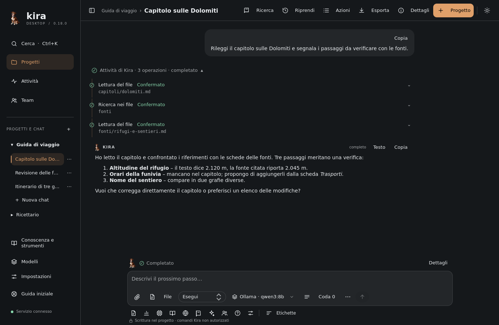
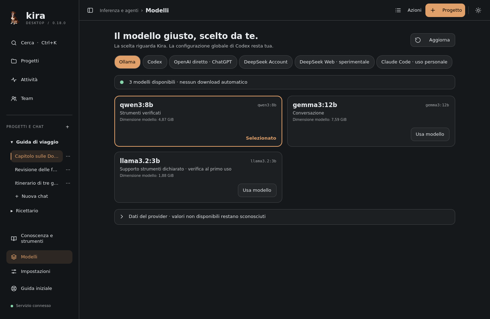
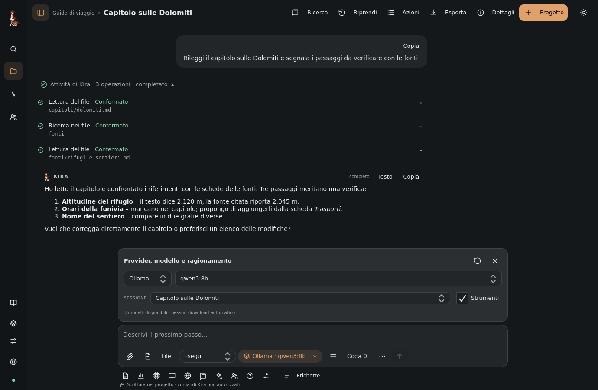
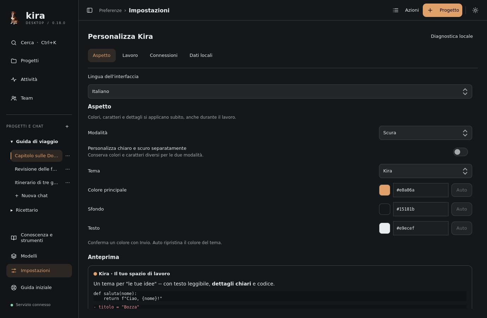

# Kira Desktop user guide

*[Leggi in italiano](../it/GUIDA_UTENTE.md)*

Kira Desktop is a native application for working with a language model on your
projects: reading and editing files, running commands, consulting the web,
coordinating a team of agents and keeping memory and results on your computer.
This guide explains how it is organized, how it is used day to day and what its
real limits are. The linked topic guides go deeper into each subject.

## Table of contents

1. [What Kira is and how it is organized](#what-kira-is-and-how-it-is-organized)
2. [First steps](#first-steps)
3. [The interface](#the-interface)
4. [Writing requests](#writing-requests)
5. [Reading results](#reading-results)
6. [Managing chats](#managing-chats)
7. [Context and memory](#context-and-memory)
8. [Providers at a glance](#providers-at-a-glance)
9. [Integrated browser and Kira's Computer](#integrated-browser-and-kiras-computer)
10. [Agent teams](#agent-teams)
11. [Project research](#project-research)
12. [Kira's Soul and Knowledge and tools](#kiras-soul-and-knowledge-and-tools)
13. [Workspace and native actions](#workspace-and-native-actions)
14. [Settings](#settings)
15. [Closing, restarting, data and backups](#closing-restarting-data-and-backups)
16. [Keyboard shortcuts](#keyboard-shortcuts)
17. [Frequently asked questions and common problems](#frequently-asked-questions-and-common-problems)

## What Kira is and how it is organized

### Projects, chats and the local service

Kira organizes work into **projects**. A project is a folder on your computer
with a name, optional instructions and a permission level. Inside a project you
open one or more **chats**: each chat has its own conversation, its own draft,
its own tools and results. In the sidebar you first choose the project and then
the chat; each chat shows only its own history.

Behind the window runs a **local service**, a separate process that executes
requests, talks to the providers, records every operation and keeps the history
in a database on your computer. The window is only a view onto that service:
you can close and reopen it while the work continues, and the colored dot at
the bottom of the sidebar tells you whether the window is connected to the
service. The service runs one autonomous job at a time for each project.

### The model reasons, Kira executes

The model (the one you choose among the connected **providers**: Ollama, Codex,
Direct OpenAI, DeepSeek, Claude Code) decides what to do and writes the
responses. Kira provides the tools — reading and writing files, commands,
browser, memory, teams — and runs them within the permissions you gave the
project. The choice of model is yours, chat by chat.

### Tool receipts are the proof of what happened

Every operation Kira performs leaves a **receipt**: a row in the conversation
with the name of the operation, the path or the command, the outcome recorded
by the service and the original data. Receipts are the source to consult to
know what was really done. Text from the model saying "I ran the command" is a
narrative: it must be compared with the receipts. In the same way, the
**Completed** status of a request confirms that the turn has ended, not that
the result is correct: to judge that, rely on responses, receipts, artifacts
and your own verification.



## First steps

### Starting Kira

If you installed the package, open **Kira Desktop** from the applications menu
(on Windows with WSL also from the Start menu) or run from any folder:

```sh
kira
```

`kira` is the short name of `kira-desktop`: the two commands are equivalent.
`kira --version` prints the installed version. In WSL a working graphical
session is required, for example WSLg.

To start from the source code, open a terminal in the root of the repository
(where `pyproject.toml` is):

```sh
uv sync --frozen
uv run kira
```

This mode requires `uv` and a supported Python environment. The folder you
launch the command from does not automatically become a project: you choose it
in the interface. Requirements, packages, profiles and data paths are in
[Installation](INSTALLATION.md).

### Getting started

On first launch the start screen offers **How Kira works**, which opens the
**Getting started** guide: project folder and permissions, provider and model,
resuming work. You can open it at any time with **Getting started** in the
sidebar. The **Next step** hint above the conversation closes with **Hide**;
Kira remembers the choice and you can show it again from **Settings → Work**.

### Creating your first project

1. Press **New project** (**Ctrl+N**), give it a name and choose an existing
   folder with **Browse…**. You can add project-specific instructions: the
   model receives them on every turn.
2. Choose the permissions from the table below and press **Create project**.
   You can change them later from **Actions → Project permissions**, when there
   is no active work in the project.

| Permission | What it allows |
| --- | --- |
| **Read only** | Reading and searching the project files. Changes and commands are refused by the service. Codex uses its own read-only mode. |
| **Project write** | Reading and writing the project files. Codex uses its own working sandbox. Commands run by Kira are not authorized. |
| **Trusted host** | As above, plus commands run with your user's permissions on the system where Kira runs. File tools stay within the project, but the working folder is not a sandbox: a command can reach the rest of the system. |
| **Full access** | Like Trusted host, plus reading, searching and writing outside the project too, in the folders accessible to your user. Operating-system permissions apply, with no automatic administrative privileges. |

"Host" means the system where the app runs: in WSL that is the Linux
environment. With **Full access** the project folder remains the starting point
for relative paths (you can give `../nearby-folder/file.txt` or an absolute
path). File tools ask for the current content before overwriting and do not
follow symbolic links. In **Settings → Work → New project permissions** you
choose the preselection for future projects; existing ones do not change. All
the details are in [Permissions and security](PERMISSIONS_AND_SECURITY.md).

### Connecting a provider

Open **Models** in the sidebar. The providers are a row of buttons: **Ollama**,
**Codex**, **Direct OpenAI · ChatGPT**, **DeepSeek Account**,
**DeepSeek Web · experimental** and **Claude Code · personal use**. Below, a
line reports the provider status with a colored dot (green connected, amber to
be connected or without models, red unavailable) and the action to take, if
any, for example **Sign in with Codex** or **Continue with ChatGPT**. Press
**Refresh** to re-read the catalog, then choose a model with **Use model** and,
when the model declares it, a reasoning level.



A model listed in the catalog does not prove that you are entitled to use it:
the first successful response confirms that. Kira never changes the model on
its own. Connecting each provider is described in [Providers](PROVIDERS.md) and
summarized later in [Providers at a glance](#providers-at-a-glance).

### The first request

Go back to the project, write a concrete request — for example "read
`README.md`, fix the typos and show me the differences" — leave the **Execute**
mode and press **Send** or **Ctrl+Enter**. The model's response and the tool
receipts appear in the conversation; below the conversation, the activity line
shows what Kira is doing and for how long. **Stop** asks for the current turn
to be interrupted. The first send saves the chat and gives it a title derived
from the request.

## The interface

### The top bar

Above the conversation there is a single bar. On the left you find the sidebar
button, the project name and the chat title. On the right:

| Button | What it opens |
| --- | --- |
| **Research** | The [Project research](#project-research) registry. It carries the number of proposals to review. |
| **Resume** | **Resume work**: last outcome, interrupted activities, next step and saved tools (**Ctrl+Shift+R**). |
| **Actions** | **Quick actions**, the searchable list of all functions (**Ctrl+Shift+P**). |
| **Export** | Saving the selected chat as Markdown, like **Export chat as Markdown**. |
| **Details** | The project details panel; Kira remembers whether you keep it open. |
| **Project** | A new project (**Ctrl+N**). |
| Theme switch | Switches between light and dark theme. |

When the window is narrow the buttons show only the icon: hover over them with
the pointer to read the name.

### The sidebar

The sidebar has three states: **Whole** (projects and chats, plus the app
sections), **Icons only** (Search, Projects, Activity, Team, Knowledge and
tools, Models, Settings and Getting started remain, with the name shown on
hover) and **Hidden**. The button at the top left and **Ctrl+B** cycle through
the states; the choice is saved in **Settings → Work → Sidebar**. The dot at
the bottom indicates the connection to the local service.

In the **Projects and chats** list a small mark indicates the current chat;
next to the chats of the open project appear signals of activity or attention
(a pending question, an error). The signals concern only the already loaded
chats of the open project: the absence of a signal says nothing about the chats
of other projects.

### The composer and the chips

The composer starts compact and grows with the text; long text scrolls while
keeping selection and cursor. Below the field, in the same card, a row of
chips gathers the commands:

- the **attachment** chip (**Attach**) picks files and images;
- **Files** opens the project file search (like typing `@`);
- the **mode** chip (**Execute**, **Plan**, **Review**, **Recap**);
- the **model** chip, which summarizes the chosen provider and model and opens
  the **Provider, model and reasoning** window.

On the right you find **Queue** with the number of waiting requests, which
opens the queue; **Chat tools** (**⋯**), which opens **Quick actions** for
history, goal, changes and chat management; **Queue** without a number, which
appears while work is in progress and adds a separate request; **Send**
(**Ctrl+Enter**). If the chat column is narrower than 820 px, **Files** shows
only its icon and the queue button only the number; below 700 px the two
groups arrange themselves on two rows.

### The Provider, model and reasoning window

Press the model chip: a window opens above the field with provider, model,
reasoning level (for the providers that offer it), session, the provider
status text and **Refresh models**. With Ollama there is also **Tools**, which
is chosen for new chats: in a chat already saved it stays locked. The
conversation does not move. **Esc** or a click outside closes it. You can open
it while the agent works to check the choices, but provider, model and
reasoning can be changed only when no work is running in the project; the
current turn keeps the model, session and permissions chosen at its start.
With **Open the model options with the chat** (in **Settings → Work**) the
window appears on its own every time you enter a chat.



### The tool tray

Below the composer there is a row of icons: **Files**, **Usage**,
**Context and memory**, **Knowledge**, **Browser**, **Project memory**,
**Soul** (or the name of the identity in use), **Team**, **Questions** and
**Web settings**. **Labels** shows the names next to the icons and remembers
the choice (also in **Settings → Work**). **Questions** carries the number of
expected answers; **Team** shows its status when it is paused, has an
assignment or is active. These buttons stay reachable even with the browser
shown beside the chat.

### The panels on the right

Knowledge, Context, Memory, Usage, Research, Files, Resume, Soul and the Team
details open in a panel to the right of the conversation. At the top of the
panel a row of tabs — **Research**, **Soul**, **Context**, **Memory**,
**Knowledge**, **Usage**, **Files**, **Resume** — lets you switch from one
panel to another without going back to the chat. In wide windows the chat
shrinks; in narrow ones the panel overlays it. In the panel title you find
**Expand panel**, **Show beside chat** and **Close panel**; **Esc** closes. A
click on the chat does not close the panel.

The message draft, the attachments and the browser remain intact while you
consult the panels: switching panels does not close the open pages nor
automatically returns control of the browser. The Knowledge, Research and
Context panels keep selection and drafts for the same project or the same
chat; another project shows separate data.

### The Models page

In **Models** every model is a card with the literal identifier, the tools
declaration, the size when the provider reports it and the declared reasoning
levels; the selected card is outlined in the accent color. The raw data
returned by the provider stays under **Provider data**, collapsed until you
open it. No value is invented: what the provider does not say remains unknown.

### Theme and reading column

The Kira theme is a warm graphite with an amber accent in dark mode and an
ivory background in light mode; the Neutral and Warm presets, custom colors and
fonts of your choice are also available. The conversation uses a centered
reading column by default: to occupy the whole width enable full width in
**Settings → Appearance**. Your messages are right-aligned with a limited
width; Kira's responses show the mascot. All the options are in
[Appearance and language](APPEARANCE_AND_LANGUAGE.md).

### Status indicators

Dots and symbols accompany every operation and every request:

| Color | Meaning |
| --- | --- |
| Pulsing theme accent color (amber in the Kira theme) | Activity in progress |
| Green with check mark | Operation confirmed by the service |
| Red | Recorded error |
| Amber | Waiting, paused or uncertain outcome |
| Gray | Queued, cancelled or unknown status |

The labels remain readable even without telling the colors apart. In the Kira
theme an activity in progress and a wait have similar tints: the pulsing, the
symbol and the label tell them apart. Green concerns the recorded outcome of
the operation: it does not certify that the goal was reached. If a request
finishes but a tool failed, Kira shows **Request finished** and the number of
failed operations. The Team has its own status (for example **Paused** in
amber) independent of the chat's. Only an activity that is really in progress
pulses; the pulsing stops when the window is hidden, when animations are
reduced (**Reduce motion** in **Settings → Appearance**) or when the row leaves
the view.

### The activity line and elapsed time

Between the conversation and the composer a line shows the mascot, the work
status (**Thinking…**, **Responding…**, **Running tools…**, **Compacting…**),
the elapsed time, **Details** and **Stop**. **Thinking…** is a conventional
waiting label, not a trace of the reasoning. The time runs from the recording
of the request and is not an estimate of the time needed to finish it; the
counter stops when the window is hidden or minimized. **Details** concerns the
current run or the last one of the selected chat.

## Writing requests

This section and the next describe the daily cycle: write, send, read. The
details of every chat command are in [Chat and tools](CHAT_AND_TOOLS.md).

### The four modes

The mode chip concerns the next request:

| Mode | What it does |
| --- | --- |
| **Execute** | Carries out the request with the project permissions. |
| **Plan** | Analyzes and proposes a plan, read only. |
| **Review** | Looks for concrete problems in the project, read only, without modifying files. |
| **Recap** | Produces a readable summary of the conversation, read only. |

The read-only modes do not change the project's saved permissions. To apply a
plan choose **Execute** and send a new explicit request. Codex's final plan
appears in the conversation as a formatted response even when it arrives as a
native plan. **Recap** produces a readable response: it does not replace
context compaction (see [Context and memory](#context-and-memory)).

### Send, Queue, Send guidance and Stop

- **Send** (**Ctrl+Enter**) starts a request in the selected chat when no work
  is in progress.
- While a turn is active in the same chat, the button becomes
  **Send guidance**: the text is added to the work in progress without
  stopping the tool already started. Guidance is text only, up to 32,000
  bytes; attachments require a separate request. With Direct OpenAI, DeepSeek
  Account and Ollama the guidance enters the next call to the model, after the
  current response or tool; with Codex Kira uses its own delivery to the active
  turn, when available. With DeepSeek Web and Claude Code guidance is not
  available: use **Queue**. Operations of a group not yet started may be
  postponed to take the correction into account. The chat distinguishes
  waiting, sending, confirmed receipt and outcome to verify: the provider's
  confirmation does not prove that the model has already applied the guidance,
  so check the response and the receipts. Model, reasoning and permissions of
  the turn remain those chosen at the start.
- **Queue** appears while work is in progress and saves a separate request for
  a later turn. If another chat is working, the message stays addressed to the
  selected chat and does not modify the other's work.
- **Stop** asks the service to cancel the current turn of the selected chat
  and waits for the outcome; to stop another chat's work, open that chat.
  Asking for the interruption is not proof that it happened: watch the status.
  **Stop** also pauses the continuations of an autonomous goal and cancels the
  automatic responses on Team results still pending for that chat.

Before sending, Kira privately keeps the identity of the chat's requests
(sends, queue, guidance, branches, provider switches, goals, compactions,
context notes, Team messages and resumes from the chat) and of the changes to
Soul, Research and project tools: reopening the window or switching chats does
not turn them into new operations and an uncertain outcome is not repeated
automatically. Team commands and native launches keep their identity only while
the window is open: after a restart, check **Activity** or the Team view before
repeating them. If you really want to proceed with a distinct request after an
uncertain outcome, first check chat, queue and **Activity**; **Manage chat →
Allow new separate requests…** asks for confirmation, sends nothing and
enables a new request that might duplicate a previous effect.

### Attaching files and images

Press **Attach** in the composer and choose the files. Images can also be
pasted from the clipboard with **Ctrl+V**, **Shift+Ins** or **Paste**, or
dragged into the window when the system forwards the drag. Each image appears
with a preview, name and dimensions and you can remove it before pressing
**Send**. Preparation is local: the content is transmitted to the provider only
together with the message. You can also send images alone, or queue them with
the text.

Images reach the model as **visual content** with **Direct OpenAI · ChatGPT**,
**DeepSeek Account** (only with the models that declare image support in the
catalog), **DeepSeek Web** (with both of its models) and
**Claude Code · personal use** (up to four PNGs). With **Codex** and
**Ollama**, **Attach** and paste insert the local path of the file into the
message, even for images: the model receives text, not pixels.

Limits for images as visual content:

| Limit | Value |
| --- | --- |
| Images per message | 4 |
| Accepted formats | PNG, JPEG, WebP, static GIF (animations are refused) |
| Source file | at most 32 MiB and 32 million pixels |
| After conversion to PNG | 8 MiB per image, 16 MiB per message |

Images in the draft are saved per chat and found again after a restart. If you
switch to a model without vision while keeping images in the draft, Kira points
it out: choose a compatible model or remove those attachments. A refusal from
the provider is shown without replacing the model. Writing or pasting only a
path remains text: it does not attach the bytes and does not let the model see
the image. Files other than images are inserted as editable references; reading
them requires available tools and permissions, and a reference does not
guarantee that the model understands that type of file.

Kira keeps private PNG copies of the sent images in the `image-attachments/`
folder of its own data; the other attachments may use `attachments/`. The
originals remain unchanged. Removing an attachment from the draft does not
delete already imported files nor the images of sent messages.

**From Windows (WSL):** in File Explorer copy the files with Ctrl+C and paste
them into Kira with Ctrl+V; Kira recognizes the paths accessible in WSL. The
transfer may take a moment: wait for the preview or the reference before
sending. Direct dragging towards the Linux window depends on WSLg: when it does
not arrive, use copy/paste or **Attach**. In the file picker the C: drive is
`/mnt/c`.

### File references with `@`

Type `@` in the message (or press **Files**) and search for a name: Kira
inserts an editable reference without sending anything. The search covers the
project folder and excludes symbolic links, generated folders, sensitive names
and files ignored by Git when available; if it hits a limit, refine the term. A
reference does not change the permissions and does not guarantee that the model
can read that type of file. **Attach** remains available to explicitly choose
other files.

### Quick actions

**Actions** in the top bar, **Chat tools** next to **Queue**, **Ctrl+Shift+P**
or the `/` character at the beginning of the message (or after a space) open
**Quick actions**: search for a function by name or description (also with
terms such as `model`, `plan`, `diff`, `queue`) and select it. The actions open
the corresponding panel or prepare a request in the draft: there is no need to
learn commands. **Ctrl+C** keeps copying the text and Tab keeps the normal
navigation between controls.

### Drafts and sent message history

The draft of every chat is saved privately and becomes available again after a
normal close and reopen; each chat keeps its own text and its own attachments.
The drafts file has an overall limit of 2 MiB, at most 100 drafts and 262,144
bytes per text. If a draft does not fit, the **Draft not saved** warning
appears: keep the text before leaving, because Kira does not silently delete
other drafts to make room. The recovery concerns the chat field, not the app's
other temporary editors.

**Sent message history** (from **Quick actions**) searches among the last 200
messages confirmed by the service, across all projects, and shows those of the
current project. **Reuse in draft** inserts the text without sending it. **Clear
local project history** deletes only this reusable list: conversations and
drafts remain. To make room for the drafts Kira may first remove the oldest
entries of this list; the conversation history stays in the database.

## Reading results

### Formatted responses

Responses show bold, italics, headings, lists, tables and code blocks, also in
already saved conversations. To copy a command without the Markdown delimiters,
select it and press **Ctrl+C**; **Copy command** in the block does the same.
**Copy** copies the whole response in its original Markdown; **Text** shows the
source and **Formatted** restores the formatted view.

Links open only on click: HTTP/HTTPS pages in the system browser, or documents
present in the project with the application chosen in **Settings → Work →
Open files with**. Scripts and executables must be opened in your editor.
Images in Markdown are shown as descriptions, without downloading anything.
Tool results remain literal text. With **Smart punctuation** (in Appearance)
only the display of prose changes: the text copied with **Copy**, the source
view and the export remain original.

### Receipts and tool groups

Operations appear as rows connected by a colored thread. Each row shows the
name (**Reading the file**, **Running the command**, **Searching text**…), the
path or the command, the recorded outcome and a limited preview of any error.
Unknown tools keep their literal name. Press the row to open the original
output, **Copy** and **Data**.

Consecutive operations of the same request are gathered in **Kira activity**,
with the number of operations and the overall status. Open the group to see the
individual rows; errors and unconfirmed outcomes remain visible even when
collapsed. Inside a row, a long output first shows a few lines: **Show all**
opens the available text and **Collapse** closes it again; **Copy** always
copies the complete content. For very large outputs use **Export** or the
artifacts. **Data** opens the event details; the files recorded as results are
in **Files** (**Project artifacts**). Not every file created by Codex commands
automatically becomes an artifact: you can also inspect the folder with
**Open folder** in the project **Details**.

Opening a row keeps the reading position and suspends automatic scrolling;
**Latest updates** goes back to the bottom and re-enables it. While you read
earlier messages, new results do not move the view. The chat view is limited to
the last 60 runs and 600 rows (the **History is limited to the latest 60 runs**
notice concerns only the displayed portion, not a deletion): **Export chat as
Markdown** saves everything. When you open a chat, Kira shows "Loading chat…"
and then directly presents the latest messages.

### Activity

**Activity** in the sidebar gathers the runs of the open project (up to the
500 most recent, excluding those of Team members): for each one the status,
the start time in the computer's time zone, an excerpt of the request, any
error, **Details** (identifiers, request, times in UTC and event information)
and **Open chat**. Every run has its own final status: several **Completed**
rows refer to different requests, not to repeated work.

### The error box

If the last request of the chat fails or is interrupted, a box appears near the
composer with the available reason and a reference to the request; **Details**
shows the complete error and, if the provider supplies them, the HTTP code and
the call identifier. The box reappears when you reopen the chat and is replaced
by the next request; earlier outcomes remain in **Activity**.

A message already present in the conversation has been saved by Kira even if
the call to the provider fails. For example **HTTP 503** indicates that the
provider was not available for that request; the code alone does not say the
precise cause. Kira shows the error without resending the request or changing
model: before retrying, check the actions already performed.

### The reasoning summary

When the provider supplies it (Codex and Direct OpenAI), **Reasoning summary**
appears below the chat: a compact preview that you can expand and select, with
the indication of the provider and of any incomplete parts. You can also
consult the summaries of earlier runs of the same chat. It is the provider's
public summary: it does not certify that an operation was performed, and
**Thinking…** keeps indicating processing. **Show reasoning summaries** in
**Settings → Work** hides or shows the panel without interrupting the work. If
the provider does not send a summary, Kira says so and continues; with Ollama,
DeepSeek and Claude Code the summary is not available.

## Managing chats

### New chat, rename, archive

**+ New chat** (**Ctrl+Shift+N**) opens an empty conversation in the project,
keeping the chosen model and reasoning level. The chat is saved on the first
send and takes its title from the first request; **⋯** next to the name lets
you rename it. Kira remembers the last chat opened for each project.

**Manage chat → Archive chat** hides from the main list an inactive chat with
no queued requests, keeping history and references. In **Archived chats** you
can open or restore it; a chat opened from there can be exported, but it must
be restored before sending new messages. Archived chats do not feed new shared
memory excerpts.

### Continue from here

**Continue from here** creates a new chat that starts from the end of the
conversation or from a completed request chosen in the list; the original
remains available. The new branch does not undo the changes already made to
the files. With Codex branching is native: intermediate points require a
boundary recorded by the provider and for less recent chats only the end may
be available; the earlier context stays with the provider and the branch's
local history starts from the new requests, with **Open original chat** in the
banner to re-read the earlier messages. With the other providers Kira
explicitly copies the recorded textual context, within the declared limits.

### Exporting and copying

**Export chat as Markdown** (also with **Export** in the top bar) saves the
whole persisted conversation with its receipts, even when the view shows only a
part of it: it includes the guidance added during the work and the partial
outputs kept. Artifact paths remain references, the files are not embedded. The
export of a branch contains what Kira recorded in that branch: for the original
history export the starting chat too. Automatic redaction recognizes only some
forms of sensitive data: always check an export before sharing it. **Copy last
response** copies the text of the last visible completed response;
**Ctrl+Shift+C** copies the conversation. The project memory is saved as JSON
with **Export JSON** in **Project memory and instructions**.

### The queue

**Queue** shows the waiting requests with destination chat, mode and status.
Before they start you can edit their text, move them with the arrows or remove
them. The queue admits up to 64 requests per project, each of at most 8,000
bytes of text.

The queue continues on its own after a completed job. After an error, a
cancellation or a service restart it stays paused: check the outcome and press
**Resume queue**. **Pause queue** prevents new starts and lets the current turn
finish. Closing the window does not stop the service and does not delete the
queue.

### Chat goal and autonomous goal

**Chat goal** (from **Quick actions**) lets you describe the desired result and
save it. While it is active, Kira includes it in the context of new turns and
shows it in a box above the conversation, with **Open** for the controls;
seeing it starts nothing. **Continue with one step** starts a single explicit
request; **Pause goal**, **Resume goal** and **Mark completed** regulate its
status without replacing **Stop** for a turn already started.

To let Kira carry the goal forward on its own, write `/obiettivo` followed by
the desired result (`/obbiettivo` and `/goal` also work) or choose **Start
autonomously** in the panel. Kira proceeds in cycles, keeps a progress summary,
waits for Team results and consults the history when it needs details, with no
cycle limit. `/obiettivo stato`, `/obiettivo pausa` and `/obiettivo riprendi`
show the progress, stop the following cycles and reactivate a stopped goal; the
English forms `status`, `pause` and `resume` work with each of the three command
words, for example `/goal pause`. The command without text opens the controls.
After a restart or an uncertain outcome Kira keeps the progress and asks for an
explicit resume. Completion is an assessment by the model, justified by recorded
results or by a deliverable: it can be wrong. Everything else is in
[Autonomous goals](AUTONOMOUS_GOALS.md).

### Persistent questions

When the model poses a choice with a structured question, Kira opens a
dedicated box: choose an answer or **Other** and write it, then press **Send
answer** when you have completed all the questions. No option is sent on its
own. You can close the box and reopen it with **Questions** or
**Ctrl+Shift+Q**: the question remains available even if new messages scroll
by. Asynchronous questions let the agent continue; blocking ones wait.

Kira distinguishes a **saved**, **forwarding** and **forwarded to the provider**
answer; the last status does not guarantee that the model has already used it.
If the turn ends or the send fails, the question is closed: copy question and
answer into a new turn. Sent questions and answers survive reconnection; free
answers not yet sent stay only in memory and are lost when leaving the app or
switching project. A question written in the text of a response does not
become a form.

## Context and memory

### Project memory

**Project memory** in the tray shows the excerpts Kira takes from the
project's other chats, with the **Use excerpts from this project's other chats**
switch. **Edit project notes** opens **Project memory and instructions** (also
from **Actions → Project permissions**): instructions, project permission
(editable when there is no active work in the project) and an editable JSON
with goal, decisions, questions and next step, shared by all the chats of the
project; **Save** records the changes. The model consults the memory with its
tools when it needs it: it is not attached to every request, while Team
members receive it in full. Keep assumptions and conclusions separate and
point to files, events or other proof: the text you write does not
automatically become a verified conclusion. **Export JSON** saves the memory.

### Excerpts from the other chats

With every request Kira adds short excerpts from the other chats of the same
project, with references: at most five chats and 6,000 additional characters.
Earlier responses are context, not verified facts. Chats from other projects are
not retrieved, nor are new excerpts from archived chats, and the excerpts do not
cross different identities (Soul). You can disable new sends; those already
received by the provider may remain in the conversation. File permissions do not
change.

### Important chat notes

In **Context and memory** you find **Important chat notes**: write a
constraint or a detail and press **Keep note**. Notes are separate from the
model's summary, stay in the initial context of every turn and survive
compaction; **Remove** deletes the note without touching the messages. You can
add or remove notes while no work is running in the project and no requests
are queued. They are available with all providers and do not replace the
project instructions or the shared memory.

### Context and memory: compaction

**Context and memory** (from the tray, from **Manage chat** or from the
**Usage** panel) shows how Kira prepares the context for the model.

With **Direct OpenAI** the mode is **Automatic — maximum available**: Kira uses
the maximum declared by the catalog and reserves space for response and tools.
The box distinguishes **Reported default window** and **Catalog-reported
maximum** (provider values), **Window used by Kira**, **Space reserved for
response and tools** and **Compaction threshold** (values used by Kira), **Last
measured request input** (reported by the provider), **Last context estimate**
and, if available, **Last provider preflight count**. Estimate and count
describe the last available calculation, not the next send. Cached tokens
still occupy context; cumulative totals do not indicate the free space.

With **DeepSeek Account** the mode is **Automatic — Kira compaction**: Kira
estimates the pressure before sending, calibrates it with the tokens reported by
the provider, keeps the recent exchanges and uses the selected DeepSeek model to
summarize the earlier ones, without tools. The summary consumes account quota.

Before exhausting the budget, even during a job with tools, Kira prepares a
more compact context: it prefers native compaction when the provider supports
it, otherwise a structured summary with the selected model. The activity line
shows **Compacting…**. After a native compaction part of the context may remain
in an internal state readable only by the provider: in that case **Last
context estimate** stays **Not available** and **Last visible content
estimate** appears. If the response of the native compaction is not usable,
Kira shows **Recovering context** and attempts a summary with the same model;
if that fails too, the earlier context remains available and the error is
reported. No command is repeated to rebuild the result.

With Direct OpenAI and DeepSeek Account, **Compact now** starts an explicit
compaction with the chat idle (finish the work and complete or remove the queued
requests). It may use plan resources and add waiting time; it does not modify
files. Closing the panel does not cancel the operation. For **Codex**, **Manage
chat → Compact context** asks the provider to compact its conversation, with
confirmation and the chat idle; Kira keeps its own history. If Codex reports a
native goal of its own still open, Kira may refuse resume or compaction. None of
these operations promises a quantity of tokens saved.

**Automatically generated memory** lists decisions, constraints, results and
open questions kept by the compaction; every entry is a statement by the
model. **Read source** opens the original passage, page by page. During a
request the assistant can search and re-read sources of the same chat; it is
not guaranteed to recall every piece of data on its own, so you can tell it
which decision to check or save a constraint in the notes. The original history
always remains exportable. More in [Context and
memory](CONTEXT_AND_MEMORY.md).

### Context supplied by Kira

**Context supplied by Kira** (in **Details**, or **Supplied context** in
**Project memory and instructions**) shows what Kira actually added to the
last run: project instructions, Soul, notes, excerpts, goal and the list of
sources the model can consult, such as the project memory. The provider may
use other internal context that is not visible; this view does not expose the
model's private reasoning.

### Ollama: requested context and internal reasoning

Ollama receives a recent, limited window of the chat, with an indication of
the omitted content; a model with verified tools can retrieve the rest. In
**Details → Requested context** you choose for this chat **Ollama default** or
**32K**, **128K** or **256K**: larger windows consume more memory and can slow
the model down, and the available RAM/VRAM may prevent loading the highest
values. In **Details** you also choose the **Model internal reasoning**
(default, off or on); Kira does not show the model's internal text. With
internal reasoning on and a long history Ollama can take a few minutes before
sending data: Kira waits up to ten minutes between one update and the next
before interrupting, a limit on the wait, not on the total duration.

## Providers at a glance

| Provider | Browser and Kira's Computer | Attached images | Teams | Autonomous goals | Reasoning summary |
| --- | --- | --- | --- | --- | --- |
| **Ollama** | Yes (tools verified on first use; screenshots and Computer only with a model that accepts images) | No (paths as text) | Yes | Yes | No |
| **Codex** | No (uses its own native tools) | No (paths as text) | Yes | Yes | Yes |
| **Direct OpenAI · ChatGPT** | Yes | Yes (up to 4) | Yes | Yes | Yes |
| **DeepSeek Account** (experimental) | Yes | Yes, vision models only | Yes | Yes | No |
| **DeepSeek Web** (experimental) | Browser yes, Computer no | Yes | No | No | No |
| **Claude Code · personal use** (experimental) | Yes | Yes (up to 4 PNGs) | No | Yes | No |

Record proposals for the Research registry are available with all providers,
with tools enabled. The complete details are in [Providers](PROVIDERS.md).

**Ollama.** You need an already configured server with an installed model. The
default value is `http://127.0.0.1:11434`, relative to the system where Kira
runs; a remote endpoint must be chosen explicitly in **Settings → Connections
→ Ollama endpoint** and will receive the context sent. Kira does not download
weights. Tools are verified on first use: models that do not declare them
remain available for conversation only. When tools are enabled, Ollama receives
files, commands according to the permissions, questions, history, knowledge,
project research, goals, browser and teams; Kira instructs it to carry out the
next step with a tool instead of announcing it, but the call remains a decision
of the model.

**Codex.** In **Models → Codex → Sign in with Codex** complete the login in the
browser, then **Refresh**. Codex must be installed separately: the package
includes neither the runtime nor an account, and Kira does not import its
authentication files. If the command is not found, set the absolute path in
**Settings → Connections → Codex executable**. Codex uses its own native
tools, its own sandbox and its own compaction; its policies limit writes and
network according to the runtime and do not promise that only the project
folder is readable. The session configuration notice and other routine
provider acknowledgements do not appear in the chat; they remain among the
run's recorded events.

**Direct OpenAI · ChatGPT.** In **Models** or **Settings → Connections →
ChatGPT accounts** press **Continue with ChatGPT**, authorize Kira in the
browser and choose a model from your account's catalog. Kira communicates
directly with OpenAI and manages the tool cycle, the questions and the Teams.
Usage shares the limits of the ChatGPT plan and those assigned to the app; Kira
never switches to a paid API key. You can add, select and disconnect several
accounts: each chat stays tied to the account chosen for it. Before changing
sign-in finish the work and empty the queue; if you revoke access in the
browser, cancel it in the account panel too. You can always disconnect Kira
from the ChatGPT settings.

**DeepSeek Account (experimental).** In **Models → DeepSeek Account** press
**Sign in with DeepSeek**: Kira opens the system browser and keeps the grant in
the local profile. Read the notice in the panel: the flow may create a managed
key on the platform that the local logout might not revoke.
**Disconnect from Kira** deletes the local grant and asks the platform to end
the session without waiting for confirmation; it does not open the site's
logout, so sign out of the site too if needed. Alternatively
**Use DeeperSeeker** connects a DeeperSeeker proxy instance (an HTTPS address,
or plain HTTP only on this computer, for example `http://127.0.0.1:4000`, and
an API key, saved and no longer shown); the proxy must already be running. To
go back to the account, clear **Use DeeperSeeker** and press
**Disable DeeperSeeker**; the saved key stays in the profile. The provider uses
Kira's tools with the same permission and approval checks.

**DeepSeek Web (experimental).** In **Models** paste the `userToken` into the
**DeepSeek Web · direct access** panel: Kira keeps it in the private profile
and verifies the session with `chat.deepseek.com`. Then choose **DeepSeek Web**
as provider and one of the models **DeepSeek V4 Flash (web)** or **DeepSeek
Reasoner (web)**. Kira mediates textual tools for browser and web search,
project, files and commands; every call respects mode, permissions and
approvals. The same remote session is reused between the messages of the chat;
if the service was interrupted during a turn, on continuation Kira restarts
from the last confirmed message and passes the model an excerpt of request and
results, without repeating the tools. **Remove web token** disconnects it.

**Claude Code · personal use (experimental).** Available only from source with
`uv sync --frozen --extra claude-code` (a `uv sync` without the extra removes
it). Kira uses the sign-in already done in Claude Code: it neither reads nor
stores the credentials and has no sign-in button of its own. If the model list
reports that Claude Code is not connected, run `claude` in a terminal, use
`/login` and then **Refresh**. Use it only for your own work. The project
permissions decide the tools; Kira blocks paths outside the project (except
with **Full access**) and shows Claude Code's actions with the same labels as
the other providers, with the native name in the original data. Background
commands are not available: Claude Code closes at the end of each run, so a
command must finish within its time limit. Claude Code's automatic memory is
disabled: memory is managed by Kira.

### Changing provider or model in the same chat

From the model chip you can change model and reasoning level without creating
another chat, when no work is running in the project: it applies from the next
request; history, draft and the provider's conversation reference remain
(DeepSeek Web, however, opens a new remote chat when the model changes). The
reasoning is kept if the new model supports it, otherwise it goes back to the
provider's default value.

To change provider, choose the new one in the same window: Kira shows model,
reasoning and, for Direct OpenAI, the account, and asks **Continue in this
chat**. It offers again the last choices saved for that provider; the first time
you must choose a model and no model is substituted if the saved one is not
available. The switch keeps title, history, text and images of the draft and
starts nothing. Kira prepares the portable context for the new provider within
declared limits, without transferring the hidden internal state of the previous
model; going back to Codex the hand-over is prepared again. Wait for the work to
finish and complete or remove the queued requests before switching.

### Usage and resources

**Usage** in the tray opens **Usage and resources**: last request,
conversation totals, context capacity and observed RAM/GPU resources. The
usage shown is the provider's last report, not an invented total across
sessions; a missing value stays **Not available** and zero appears only when it
is reported. The context capacity is not a measure of the remaining tokens and
the computer's resources do not indicate the consumption of a remote model.
**Original data** shows the JSON.

**Account usage** (from **Usage** or **Manage usage**) shows the data of the
selected provider; the selector is for consulting and does not change the
chat's provider. For **Codex**: remaining percentages, period, reset date and
credits, with the date of the reading and **Refresh**. For **Direct OpenAI**:
the chat's account and the locally recorded tokens; the connection does not
expose quotas, so **Open ChatGPT** goes to the plan page and **Copy link**
copies its address (check that the browser is signed in to the same account).
For **Claude Code**: the session window (5 hours) and the weekly one with the
remaining percentage, reset time and extra usage, as Claude Code communicates
them during runs; without a recent turn the measure remains that of the last
run. Below the chat a line summarizes the share already used,
**Claude plan · session X% · week Y%**, with **Details**; **Open claude.ai**
goes to the usage page.

## Integrated browser and Kira's Computer

Kira includes an isolated browser that the model can use for web search,
reading pages and, with **Kira's Computer**, visual control with mouse and
keyboard. It is available with all providers except Codex, which uses its own
tools. The complete guide, including passkeys and WSL, is in [Browser and
Computer](BROWSER_AND_COMPUTER.md).

### Preparation

Run once, with the same profile as the app:

```sh
kira-desktop browser-install
```

(from source `uv run kira-desktop browser-install`). Kira downloads a dedicated
Chromium engine; from source the Linux packages `xvfb` and `libxtst6` are also
needed, which the native packages declare among their dependencies.

### Opening the browser

Press **Browser** in the tray: the browser appears beside the conversation,
with tabs, address bar, back, forward and reload. Type a full address or a
domain such as `google.com` and press Enter (without a protocol HTTPS is used).
You can widen the panel by dragging the divider or with **Expand browser**; in
narrow windows you alternate between browser and chat without losing the
draft. The **⚙** icon opens the chat's web options. The agent can open the
browser on its own when needed: a request such as "read this link" is enough. A
network ban in the project instructions continues to apply.

With Direct OpenAI the chat tools must be enabled and in the web options you
choose the search hosted by OpenAI among **Live access**, **Indexed content**
and **Search disabled** (it depends on the model and the account; a refusal is
shown without changing model). With the other providers search uses
`browser.search`, which opens Google's results in Kira's isolated browser.
Sources appear as links in the responses and the operations in **Activity**;
if the provider confirms a web operation without reporting its details, Kira
leaves them unavailable. Sources are not invented.

### Consent to actions

The agent can read text and structure, search within the page, scroll and
capture an image on its own. Clicks and typing require **Execute**, a project
with write permission and your consent: **Allow once** authorizes the single
action, **Always allow in this chat** all those of the chat. The same choice is
in **⚙ → Always allow the agent's actions in this chat**, is saved immediately
even during the work, covers browser and Kira's Computer and the browser bar
shows **actions allowed**. The consent remains after a restart and does not
extend to other chats; if you change provider or account or create a branch,
Kira asks again for each action. Disabling it does not undo actions already
performed. Manual login, passkeys and project commands keep their own
confirmations.

### Take control and manual login

**Take control** gives you mouse and keyboard in the **Full browser** view
(which also includes Chromium's dialogs); the agent's actions wait with
**Waiting for browser · your control**. **Return to Kira** lets it continue;
**Stop** interrupts the request. Kira neither takes the browser back nor
repeats operations on its own. What you type in the browser does not enter the
draft.

The default profile is temporary and separate from your personal browser; page
and tabs remain open between the messages of the same chat. To sign in to a
site, ask Kira for a **manual login**: enter passwords and codes directly in
the site inside the panel and press **Done**; **Keep control** leaves the
browser to you. Do not write credentials in the chat. To keep the sign-in even
after closing the browser, first enable **Keep the browser profile for this
chat** in the web options: the profile is distinct per chat, account and
provider, and the chat uses it again whenever it returns to that provider and
account. Disabling retention does not delete the profile already saved: it
remains available if you enable it again. Session-only cookies may still
disappear on close.

### Closing and limits

The end of a turn leaves the browser open. Hiding the panel or minimizing Kira
only suspends the update of the view; **×** and **Close browser** really end
the Chromium session and invalidate pending actions. You can also ask Kira to
close it (`browser.close`, limited to this chat's browser). When Kira's last
window disconnects, the service closes the inactive browsers.

Pages must be reachable via HTTP/HTTPS: local addresses, file uploads and
automatic downloads are not available. Some sites require manual intervention
or block automation: Kira cannot guarantee that a site accepts automation and
must point out the observed obstacle. Form fields are excluded from readings
and masked in the screenshots meant for the model; continuous updates of the
view are neither sent to the model nor saved. Profiles with sign-ins and
screenshots must be included in the data backup. Close the browser before an
update.

### Kira's Computer

With **Kira's Computer** the model observes a screenshot of the browser,
decides where to act (click, double click, drag, scroll, keyboard) and checks
the result with a new screenshot. It requires tools enabled, the chat's
browser, **Execute**, write permission and the consent described above. If the
page changes while the model decides, the action on the old screenshot is
refused and the model must observe again; unconfirmed operations are not
repeated. Each request has at most 32 visual cycles; the original images
remain in the private artifacts and the model keeps the two most recent ones.
With Ollama a model that accepts images is needed; with DeepSeek Web the
Computer is not available.

## Agent teams

A **Team** makes several agents work together on a goal: a coordinator assigns
tasks, the members carry them out and write to each other through a message
box managed by Kira. Independent analyses proceed in parallel; file changes
are made by one member at a time. Roles indicate responsibilities, but the
effective permissions remain those of the project and a reader always uses
read only. It works with Codex, Direct OpenAI, Ollama and DeepSeek Account; the
details are in [Teams](TEAMS.md).

### From the Team view

Open a project and switch to **Team** in the sidebar. Write the goal and
choose: **Set up manually** (total number, with name, specialization,
instructions and access of every member; the coordinator is included) or
**Let Kira organize** (maximum number; the coordinator examines the project,
proposes the tasks and starts the team). All the members use the model and
reasoning chosen for the team. The total goes from 1 to 12 members with at
most 8 simultaneous tasks; the default coordination limit is 3 cycles (0 = no
limit) and reaching it pauses the team while keeping the outcomes.
**Start team** starts the team: a configuration that is not started is not
saved.

The coordinator must assign concrete tasks before the members start; a message
in the box alone does not start work. Kira does not conclude a multi-member
Team without recorded outcomes from the collaborators: if the coordinator
closes too early, Kira asks for a correction of the plan within the cycle limit
and, if that is not enough, pauses the Team with a reason. A Team concluded
without recorded member outcomes is flagged **Conclusion needs review**.

### From the chat

With Codex, Direct OpenAI, Ollama or DeepSeek Account and tools enabled you can
ask for a Team directly in the chat (with Ollama the model must support tools),
for example: "Organize a team of three members: a coordinator, a test analyst
and an independent reviewer, read only". Claude Code and DeepSeek Web do not
run Teams, so their chats cannot request one. The team inherits the chat's
model, reasoning and permissions and receives goal, deliverable, decisions and
references to the proof, not the whole history. The assistant records the
delegation, the turn ends, the team starts and the chat shows the progress
with a **TEAM** card. At the end, for Teams started or resumed from the chat,
Kira answers on its own in the conversation distinguishing the completed tasks
from the verification of the goal; it starts no other Teams and the queued
requests take precedence. **Plan**, **Review** and **Recap** do not start
delegations.

### Conversing during the Team

While the Team works you can talk to Kira in the chat: **Read-only
conversation** appears. File changes stay with the Team and browser actions
are suspended; use **Queue** for a new task that requires changes. You can send
guidance to the coordinator from the Team view. A recorded message does not
prove that an agent has read it. In **Team → Run details** you read the events
in order with **Readable view** and **Original JSON**, **Copy JSON**, **A− /
A+** for the text and **− / +** to expand an event.

### Stopping, resuming and the cycle limit

**Stop team** asks for all the tasks to be halted: wait for the confirmation.
Closing the window lets the service keep working; shutting down WSL or the
system can interrupt it. After an interruption Kira shows the preserved state
and asks for an explicit continuation: **Resume** in the Team view,
**Resume team** or **Continue team** in the chat's **Team** panel, or the
sentence "Resume the Team using the previous results". The resume keeps model,
reasoning, account, constraints and results and does not repeat operations
with an uncertain outcome; duplicate requests do not create copies. A change
of model, account, permissions or an archived chat prevents an automatic
resume. The **Rounds on resume · 0 = unlimited** field lets you change the
cycle limit for the continuation (also with "Resume this Team with cycle limit
0"); with zero the protections against lack of progress and uncertain outcomes
remain active.

## Project research

**Research** in the top bar opens a registry for the project's goals,
hypotheses, experiments, observations, decisions and open questions. It does
not run experiments: it helps to keep and evaluate what you know. The **What
we know**, **Evidence and attempts** and **Next step** views organize the
records; **Proposals** gathers those suggested by the assistant (**Accept**
accepts them as they are, **Open record** opens them for editing). You can
search for a word in the registry without starting a model.

With **New record** you choose type, title and content; **Link a source**
attaches a run, an event, a result or a recorded artifact (**Read original**
shows the literal content); in **Scope, criteria and dependencies** you state
conditions and evaluation criterion; **Supported by sources** and
**Contradicted by sources** are human assessments that require scope,
criterion and at least one source. **Save record** creates a revision; the
earlier ones remain available for consultation. Dependencies on files are
recorded with **Capture file hashes** and checked with **Recheck registered
files**.

Sharing with the chats is disabled at the start: **Share the registry with
project chats** authorizes the assistant to consult the accepted records and the
linked sources with its tools, and **Read shared context** shows a summary of
them; the records are not added to every request. With tools enabled the
assistant can consult the registry and propose records, but not accept its own
proposals. The registry's drafts are separate from the chat draft and survive a
restart. Everything else is in [Research](RESEARCH.md).

## Kira's Soul and Knowledge and tools

### Kira's Soul

Press **Soul** in the tray or open **Settings → Work → My Kiras**. Describe an
identity with name, philosophy and way of collaborating, press **Create
identity** (then **Save identity** for changes) and **Use in this chat**. You
can have several Kiras, for example one for study and one for design; in a new
chat choose the identity with **Use in the new chat** before the first message,
and the choice remains even if you close and reopen the window. The short core
(up to 1,200 UTF-8 bytes) is given to the model on every turn, even after
compaction; the more extensive memories are searched when needed. A specific
request always prevails over general preferences.

Choose how it should evolve: **Manual** (you edit identity and preferences
yourself), **Suggestions** (Kira proposes lessons that you read in **What it
learned** and decide with **Keep** or **Dismiss**) or **Adaptive** (it applies
explicit preferences on its own). In Adaptive mode a message made only of

```text
/anima preferenza tono=naturale e diretto
```

updates the preference; the keys are `tono`, `dettaglio`, `collaborazione`
and `lingua` (the English names `tone`, `detail`, `collaboration` and
`language` also work). In Suggestions the command produces a
proposal; in Manual it does nothing. Free text never becomes a rule on its own.
**Helpful / Not helpful** influences the order of the memories; **Forget**
excludes a lesson; **Evolution** shows the revisions and lets you restore one.
**Copy profile**, **Import profile** and **Duplicate** transfer core and
preferences without memories; **Archive** deactivates a Kira while keeping its
data. To change identity in an existing chat, finish the work and pause any
goal; the change also closes the chat's browser, keeping a retained profile.
Details in [Soul and Knowledge](SOUL_AND_KNOWLEDGE.md).

### Knowledge and tools

**Knowledge and tools** in the sidebar (or **Knowledge** in the tray) shows
what Kira knows about its own environment: selected project and chat, model,
reasoning, mode, effective permissions, active jobs, available tools, saved
goal and current request. The search finds guides, original sources of the
chat, project memory and registered tools; consulting them does not start the
model. The project instructions and the important notes stay in the initial
context; guides, reference memory and catalogs are read on request, in limited
pages.

In the **Tools** tab you see the project's tools with revisions, contracts and
recorded tests. You can disable one or add to the draft a request to use or test
it (the button does not send). When a capability is missing, you can ask Kira to
prepare a reusable tool: a Python script that receives and returns JSON.
Registration keeps an exact copy of the code; later changes require a new
revision and new tests. Creating and registering require **Execute** and project
write; testing and running require **Execute** and **Trusted host** or **Full
access**, because the code acts as your user. The tests verify the declared
cases, not every external effect. No dependencies are installed and no
credentials are imported.

## Workspace and native actions

### Resume work

**Resume** in the top bar (**Ctrl+Shift+R**) opens **Resume work**: the last
recorded outcome, the interrupted activities and an editable **Next step** note.
Choose **Folder**, **Terminal** and **Editor**, press **Save changes** and then
**Open saved tools**: Dolphin opens the project folder, Konsole starts in that
folder and Kate opens a new session with the same working folder. This action
opens applications without repeating the commands of old runs. Interrupted
operations are never repeated automatically.

### Ctrl+K

**Ctrl+K** searches projects and native actions, which use fixed KDE Plasma
and Firefox applications: the project's folder, terminal and editor (Dolphin,
Konsole, Kate), Firefox, Plasma settings, System Monitor, Discover for
updates, Déjà Dup for backups, a screenshot with Spectacle and a Google search
in Firefox. A missing application or an unavailable graphical session is
reported; "Launch requested" means that the request was sent to the
application. The boundaries of native actions are in [Permissions and
security](PERMISSIONS_AND_SECURITY.md).

### Reference files and Screenshots

In **Reference files** you link a path relative to the project to a conclusion
and press **Recheck**: Kira tells you whether the file is unchanged, changed,
missing or unreadable. **Update reference** accepts the new version;
**Unlink** removes the reference without touching the file. The comparison
signals when to revisit a conclusion, it does not certify that it is correct.

**Screenshots** explicitly captures the full screen and keeps the file among
the project's proofs (in the `captures/` folder of the data); the list shows
the 100 most recent screenshots and you can open them to check them.

### Opening files

Links to project files and artifacts open with the system's default
application or with **Visual Studio Code**, according to **Settings → Work →
Open files with**. For VS Code the `code` command must be available; if it is
missing, Kira says so instead of trying alternatives.

## Settings

The **Settings** are divided into four sections; unsaved fields remain when
switching from one to another.



### Appearance

**Light**, **Dark** or **Follow system** mode; Kira, Neutral or Warm theme;
custom accent, background and text colors (hexadecimal code, **Auto** restores
the theme color); font and style among those installed with separate sizes for
interface (12–18 px), conversation (12–20 px) and code (10–20 px); **Customize
light and dark separately**; animations (**Follow system**, **Always**,
**Never**), sidebar translucency, contrast, conversation width, hand cursor,
**Smart punctuation**; **Copy theme**, **Export theme**, **Import theme** and
**Reset appearance**; **Interface language**. Changes apply immediately, even
during work. Details in [Appearance and language](APPEARANCE_AND_LANGUAGE.md).

### Work

- **My Kiras**: the Soul identities.
- **Conversation**: **Comfortable** or **Compact** density; **Sidebar**
  (**Whole**, **Icons only**, **Hidden**); **Labels next to the tool icons**;
  **Open the model options with the chat**; **Show reasoning summaries**;
  **Show the Details panel**; **Show the “Next step” hint**.
- **Window and files**: **Ask for confirmation before closing the window**
  (**When work is running**, **Always**, **Never**); **Open files with**
  (system application or Visual Studio Code).
- **New project permissions**: the preselection for future projects.

### Connections

**ChatGPT accounts** (connecting, selecting and disconnecting accounts),
**Ollama endpoint**, **Codex executable**, **Tool timeout (seconds)**, **Tool
round limit (0 = unlimited)** and **Maximum output per run (bytes, up to 16
MiB)**. These settings apply only with **Save settings** and, while work is in
progress, remain read only until it ends. Output truncations are reported in
the receipts.

### Local data

**Back up database**, **Refresh resources** (re-reads the observed RAM/GPU),
the list of **Shortcuts** and the installed version. The **Local diagnostics**
button, at the top of the Settings page, shows the filtered diagnostic report
and lets you export it after reading it.

### Interface language

In **Settings → Appearance → Interface language** choose **Italiano** or
**English**: the change is immediate and is remembered. Commands, windows,
statuses and messages of the app are translated; project and chat names,
drafts, instructions, code, paths and model responses remain original, and the
choice does not change the language of the model's responses. New teams
receive initial names and roles in the chosen language; existing ones keep
their own text.

## Closing, restarting, data and backups

### What happens when you close the window

Closing the window does not interrupt the work: the service continues as long
as your user session remains active, and the queue stays saved. To interrupt a
turn use **Stop**. Shutting down WSL, turning off the computer or a service
crash are different events: on reopening, activities without a certain outcome
become **interrupted** and are not repeated; the queue pauses and a saved goal
does not restart on its own. Check files and results before continuing. **Ask
for confirmation before closing the window** in **Settings → Work** regulates
the warning.

### Where the data lives

Project files stay in the folders you chose. Everything else lives in your
user's paths, separate from the app sources. Without `KIRA_HOME` Kira uses the
XDG variables of your environment and, if they are missing or empty, these
paths:

| Content | Default path |
| --- | --- |
| Database `kira.sqlite3`, `artifacts/`, `attachments/`, `image-attachments/`, `captures/`, `diagnostics/`, `exports/`, `browser-engine/`, `browser-profiles/`, `browser-temporary/` | `$HOME/.local/share/kira/` |
| Interface preferences | `$HOME/.config/kira/ui.json` |
| Chat drafts and reusable history | `$HOME/.config/kira/composer.json` |
| Drafts and pending identities of Soul, Research and project tools | `composer.json` in `$HOME/.local/state/kira/souls-ui/`, `research-ui/` and `knowledge-ui/` |
| Service state and logs | `$HOME/.local/state/kira/` |
| Private communication with the service | `$XDG_RUNTIME_DIR/kira/service.sock` (without `XDG_RUNTIME_DIR`: `$HOME/.local/state/kira/runtime/service.sock`) |

Setting `KIRA_HOME` to an absolute path outside the sources, Kira groups
everything in `config/`, `data/`, `state/` and `runtime/` inside that folder;
the value must be the same for interface, service and commands. Uninstalling
the package does not delete this data nor the project folders. References to
saved files may contain absolute paths: if you move folders or change computer,
check that they remain accessible. Profiles and paths are in
[Installation](INSTALLATION.md).

### Database backup

**Settings → Local data → Back up database** (or `kira-desktop rpc
database.backup`) creates a consistent copy of the SQLite database. It does not
include attachments, artifacts, preferences, drafts, browser profiles or the
project folders: to keep everything you also need a copy of the profile's data,
configuration and state folders, with the service stopped. Do not copy the
SQLite file alone while the service is running: confirmed data may still be in
the WAL. Test the restore on a separate copy before replacing the current data.

### Updates at a glance

Before updating: finish the work, pause the queue, close the browser, make the
backup, close the window and run `kira-desktop stop-service` (from source
`uv run kira-desktop stop-service`), which refuses to stop while work is in
progress or a browser is under your control, and says why. After the update
Kira updates the database on its own after a consistent backup; an older
version does not open a newer database, so going back requires the backup made
beforehand. The complete procedure is in [Installation](INSTALLATION.md).

## Keyboard shortcuts

| Shortcut | Action |
| --- | --- |
| **Ctrl+Enter** | Send the message, or send guidance to the active turn |
| **Ctrl+B** | Change the sidebar state (Whole, Icons only, Hidden) |
| **Ctrl+K** | Search projects and native actions |
| **Ctrl+N** | New project |
| **Ctrl+L** | Move the cursor to the composer |
| **Ctrl+Shift+N** | New chat in the project |
| **Ctrl+Shift+P** | Quick actions (also `/` at the beginning of the message or after a space) |
| **Ctrl+Shift+R** | Resume work |
| **Ctrl+Shift+Q** | Open the pending questions |
| **Ctrl+Shift+C** | Copy the conversation |
| **Ctrl+C** | Copy the selected text (in code blocks without the delimiters) |
| **Ctrl+V** / **Shift+Ins** | Paste text, paths or images from the clipboard |
| **Esc** | Closes the model window, the panel on the right or a box |
| `@` | Search for a project file to insert into the message |

## Frequently asked questions and common problems

**I closed the window: does the work continue?**
Yes. The local service continues as long as your user session remains active;
the window is only the view. To interrupt a turn you need **Stop**. Shutting
down WSL or turning off the computer, instead, stops the service too.

**Why does "Completed" not mean the result is right?**
"Completed" confirms that the provider closed the turn. To know what was done
read the tool receipts, the artifacts and the files; if a tool failed, the
activity line says so (**Request finished** with the number of failed
operations).

**The model says it ran a command but I do not see the receipt.**
Then it did not run it through Kira: the text is a narrative. Check
**Activity** and the tool rows; if they are missing, explicitly ask for the
operation to be performed or verify it yourself.

**The request failed with HTTP 503 (or another error). Should I resend it?**
The error box shows what the provider reported; Kira resends nothing on its
own. Before retrying, check in **Activity** and in the receipts which actions
had already been performed, so as not to duplicate them.

**The draft is not saved.**
The **Draft not saved** warning indicates that the drafts file has reached a
limit (2 MiB overall, 100 drafts, 262,144 bytes per text) or is not writable.
Copy the text outside Kira before closing, then shorten or delete the other
drafts and remove the images you do not need; clearing the sent message history
does not help, because Kira already discards it on its own to make room.

**The browser asks for consent on every click.**
That is the default behavior. Open **⚙** in the browser and enable **Always
allow the agent's actions in this chat**, or choose **Always allow in this
chat** in the popup. It applies only to that chat; if you change provider or
account or create a branch, Kira asks again for each action.

**Dragging from Windows does not work.**
It depends on WSLg. Copy the files in File Explorer with Ctrl+C and paste them
into Kira with Ctrl+V, or use **Attach** (the C: drive is `/mnt/c`). Wait for
the preview before sending.

**I attached an image but the model does not see it.**
With Codex and Ollama images arrive as a textual path. Images as visual
content require Direct OpenAI, DeepSeek Account (vision models), DeepSeek Web
or Claude Code, and a model that supports them: Kira warns if the selected
model does not support images.

**The Send button has become "Send guidance".**
There is an active turn in the chat: the text is added to the work in
progress. For a separate request use **Queue**; to stop the turn use **Stop**.

**The queue does not restart.**
After an error, a cancellation or a service restart the queue stays paused on
purpose. Check the outcome of the last request and press **Resume queue**.

**I can no longer find the beginning of the conversation.**
The view shows the last 60 runs and 600 rows. Nothing has been deleted:
**Export chat as Markdown** saves the whole conversation, and the model can
re-read the earlier passages through **Read source** and the search in the
chat history.

**The model is not in the list, or it is but the request fails.**
Press **Refresh** in **Models** and check the provider status (amber or red
dot). A model in the catalog does not prove that your account can use it: only
a successful response confirms that. For Codex also check **Codex executable**
in **Settings → Connections**.

**Ollama is extremely slow or does not respond.**
With internal reasoning on and a long history it can take minutes before
sending data; Kira waits up to ten minutes between one update and the next.
Reduce **Requested context** in **Details** or turn internal reasoning off;
check in Ollama that the chosen model and context fit in memory.

**I want to change the project permissions but the field is locked.**
Permissions are changed in **Actions → Project permissions** only when there is
no active work in the project: wait for the end of the turn or use **Stop**,
then **Save**.

**Where do screenshots and attachments end up? Does the backup include them?**
In `$HOME/.local/share/kira/` (`captures/`, `attachments/`,
`image-attachments/`, `artifacts/`). **Back up database** copies only the
database: for a complete backup also copy that folder and the configuration
and state folders, with the service stopped.

**Kira restarted and a Team or a goal is stopped.**
That is intentional: after an interruption Kira does not repeat operations
with an uncertain outcome. Check the preserved state and resume explicitly
with **Resume team**, **Continue team** or `/obiettivo riprendi`.

**Can I use Kira in English?**
Yes: **Settings → Appearance → Interface language → English**. It changes only
the interface, not the language the model answers in.
