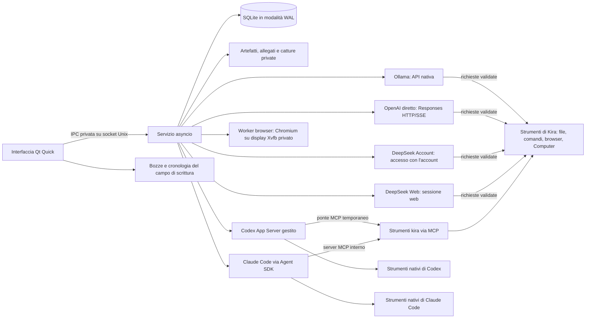

# Architettura di Kira Desktop

Questa pagina spiega come è fatta Kira sotto l'interfaccia: quali processi
esistono, chi possiede i dati, che cosa succede dopo un riavvio e perché alcune
scelte sono state fatte così. È rivolta a chi vuole capire il funzionamento o
contribuire al codice; i dettagli di metodi IPC, eventi e permessi sono nel
riferimento [Contratti](CONTRATTI.md).

## Confini tra processi

Kira è composta da un'interfaccia nativa Qt, da un servizio utente indipendente
e da un adapter per ogni provider, tutti nella sessione dell'utente.

L'interfaccia raccoglie le intenzioni dell'utente e mostra lo stato. Il servizio
possiede l'esecuzione ed è l'**unico processo che scrive nel database SQLite**.
È un processo utente non privilegiato, indipendente dalla finestra, avviato da
un'unità systemd utente dove disponibile e altrimenti come processo staccato;
non esiste alcun servizio di sistema né alcun "linger" attivo.

I provider si dividono in due famiglie:

- **Ollama, OpenAI diretto, DeepSeek Account e DeepSeek Web** fanno inferenza
  mentre Kira gestisce un piccolo ciclo di strumenti proprio: il modello chiede
  uno strumento, il servizio valida la richiesta, la esegue e restituisce il
  risultato. OpenAI diretto usa un gestore OAuth del servizio e un trasporto
  Responses HTTP/SSE senza passare da Codex App Server; DeepSeek Account usa
  l'accesso con il tuo account DeepSeek (oppure un'istanza DeeperSeeker con
  chiave API); DeepSeek Web riusa una sessione web e risolve la sfida
  proof-of-work con un modulo WebAssembly eseguito in wasmtime. I file delle
  credenziali sono configurazione privata e non entrano nelle esportazioni.
- **Codex e Claude Code** possiedono i propri strumenti nativi. Kira osserva le
  loro notifiche (una sola volta: una notifica osservata non viene mai rieseguita
  da Kira) e offre in aggiunta i propri strumenti `kira` attraverso MCP.

Il browser isolato gira in un **worker separato**: un Chromium con interfaccia
grafica su un display Xvfb privato, posseduto dal servizio. Né l'interfaccia né
i provider parlano direttamente con Chromium; ogni azione passa dal servizio.

## Proprietà durevole e recupero

Il modello dei dati segue una gerarchia semplice:

- Un **progetto** possiede la sua cartella, le istruzioni, il permesso e la
  memoria.
- Una **chat** (sessione ordinaria) ha un nome, appartiene a un solo progetto e
  conserva il proprio riferimento al provider e la propria cronologia. Cambiare
  provider nella stessa chat ritira la generazione corrente del provider e ne
  apre una nuova senza riferimento nativo: un identificatore di thread nativo
  non viene mai trasferito da un provider all'altro.
- Una **esecuzione** (run) possiede gli eventi sequenziati e le prove reali di
  strumenti e artefatti.

`run.start` porta con sé un identificatore di richiesta durevole. Il servizio
verifica permesso e lavoro attivo, salva stato ed eventi **prima** di pubblicarli
agli abbonati e, se riceve di nuovo la stessa richiesta, restituisce la stessa
esecuzione invece di crearne un'altra. Le istantanee includono dei cursori;
replay e sottoscrizione dal vivo sono deduplicati dalla coppia `(run_id, seq)`.

Vale una regola di ammissione: **una sola esecuzione ordinaria attiva per
progetto**. I Team prenotano le radici che si sovrappongono: i lettori vengono
schedulati in parallelo, gli scrittori restano esclusivi finché il provider non
ha completato la pulizia.

Dopo un riavvio del servizio il lavoro non terminato viene **interrotto, non
ripetuto**. Una pulizia che non ha registrato l'identità di alcun processo non è
verificabile prima di un riavvio del sistema: resta in sospeso fino al riavvio
del computer, poi il successivo avvio la rilascia. Una cancellazione richiesta è
distinta da una cancellazione confermata, e l'interfaccia le mostra in modo
diverso. Un esito positivo riportato dal provider non è una verifica
indipendente di ogni affermazione del modello: la chat mostra messaggi e
ricevute degli strumenti, la sezione Attività conserva il riepilogo del ciclo di
vita di ogni esecuzione.

Il servizio possiede anche la coda delle richieste, i metadati di archivio e
diramazione delle chat, gli obiettivi e le identità delle azioni native. Le
richieste in coda conservano sessione e modalità scelte, sono modificabili solo
prima della spedizione e usano identità stabili: un completamento confermato fa
avanzare la coda; errore, cancellazione o riavvio del servizio la mettono in
pausa. Un esito incerto di un'operazione nativa resta registrato e non può
essere ritentato riusando la stessa identità.

Le **indicazioni** (**Invia indicazioni**) puntano a un'esecuzione ordinaria
attiva precisa. L'intenzione viene salvata prima della spedizione al provider;
la presa in carico è distinta dal consumo da parte del modello, e un'indicazione
accettata diventa un messaggio utente durevole. Polling e riconnessione
dell'interfaccia leggono questi record, non creano lavoro sostitutivo.

## Contesto e permessi

Le istruzioni e la memoria mantenute dall'utente sono ispezionabili. Salvo che
il progetto lo disattivi (`share_session_summaries:false`), Kira aggiunge
estratti limitati da al massimo cinque altre chat ordinarie dello stesso
progetto (6000 caratteri aggiuntivi in totale), con il riferimento alla fonte e
l'etichetta di affermazione non verificata; esclude progetti esterni, chat
archiviate, sessioni dei Team e chat con un'altra identità Anima. Il blocco
fornito al modello resta registrato come evento. Questo contesto non rimuove ciò
che un thread persistente del provider ha già ricevuto e non limita i permessi
sul file system degli strumenti.

Il servizio applica i permessi **indipendentemente dall'interfaccia**:

- Gli strumenti file integrati validano che i percorsi stiano dentro il progetto
  (fuori solo con **Accesso completo**) e verificano gli hash attesi prima di
  modificare un file.
- I comandi arbitrari (vettore `argv`, senza shell) richiedono il permesso
  **Host fidato** o **Accesso completo** e agiscono come l'utente: la cartella di
  lavoro non è una sandbox.
- Codex riceve una mappatura del permesso di progetto sulla propria policy
  nativa. Dati esterni (testo del progetto, pagine web, risposte di altri agenti)
  non possono allargare la policy scelta; configurazione globale e credenziali
  dei provider non vengono toccate.

Le modalità **Pianifica**, **Revisione** e **Riepiloga** sono proprietà di una
singola esecuzione: restringono la policy effettiva alla sola lettura senza
cambiare il permesso salvato del progetto. Un piano non viene eseguito
automaticamente e un riepilogo leggibile non compatta il contesto nativo: la
compattazione è un'operazione separata ed esplicita del provider. L'obiettivo
attivo di una chat e il testo d'origine limitato di una diramazione copiata sono
contesto ispezionabile; nessuno dei due avvia un ciclo automatico.

La ricerca dei file del progetto e l'anteprima Git girano in **worker limitati**
fuori dal ciclo di eventi del servizio. La ricerca esclude link simbolici,
percorsi sensibili di default e percorsi ignorati. L'ispezione Git disabilita
helper esterni di diff e conversione e gli hook, non applica modifiche e limita
sia l'output del sottoprocesso sia la dimensione della risposta IPC.

## Presentazione e archiviazione

Il Markdown dell'assistente passa da un **renderer limitato** nell'interfaccia.
Il contenuto di strumenti e approvazioni è letterale; script generati, QML e HTML
grezzo non vengono mai valutati e il rendering non scarica immagini. I link
espliciti a documenti locali sono validati contro il progetto corrente. Le
anteprime compatte degli strumenti non cambiano il contenuto durevole.
L'inserimento da appunti o da file produce percorsi modificabili; le immagini
importate sono PNG privati e non conferiscono nuovi permessi di esecuzione.

| Posizione predefinita | Contenuto e proprietario |
| --- | --- |
| `~/.config/kira/ui.json` | Preferenze dell'interfaccia, validate e salvate atomicamente (GUI) |
| `~/.config/kira/composer.json` | Bozze limitate, cronologia dei messaggi inviati e identità in sospeso delle richieste della chat (GUI) |
| `~/.local/share/kira/kira.sqlite3` | Progetti, chat, eventi, Team, coda, obiettivi e impostazioni (scrive solo il servizio) |
| `~/.local/share/kira/artifacts/` | Output catturato, con limiti di dimensione (servizio) |
| `~/.local/share/kira/attachments/` | Immagini importate dall'interfaccia |
| `~/.local/share/kira/image-attachments/` | Immagini allegate alle richieste (servizio) |
| `~/.local/share/kira/captures/` | Screenshot nativi richiesti esplicitamente |
| `~/.local/share/kira/diagnostics/` | Diagnostica richiesta dall'utente, con filtro dei campi |
| `~/.local/share/kira/exports/` | Esportazioni private troppo grandi per una risposta IPC |
| `~/.local/share/kira/browser-engine/`, `browser-profiles/`, `browser-temporary/` | Chromium scaricato e profili del browser isolato (servizio) |
| `~/.local/state/kira/` | Stato e log del servizio staccato |
| `~/.local/state/kira/souls-ui/`, `research-ui/`, `knowledge-ui/` | Bozze e identità in sospeso di Anima, Ricerca e strumenti di progetto (GUI) |
| `$XDG_RUNTIME_DIR/kira/service.sock` | Socket IPC privato; in mancanza, cade nella cartella di stato |
| Cartella del progetto scelta dall'utente | I file reali del progetto, separati dai dati dell'applicazione |

Le variabili XDG corrispondenti sovrascrivono questi valori. `KIRA_HOME=/percorso/assoluto`
raggruppa `config/`, `data/`, `state/` e `runtime/` sotto una sola cartella
privata; non isola i file dei progetti, le credenziali né i permessi dell'host.
La cartella del socket ha modo `0700` e il socket `0600`, con un lock di processo
a scrittore singolo. Profili e backup: [Installazione](INSTALLAZIONE.md).

## Decisioni architetturali

- **Python e Qt nativi.** Un pacchetto per Ubuntu 24.04 (Python 3.12) e uno
  separato per Ubuntu 26.04 (Python 3.14), entrambi con PySide6 Essentials / Qt
  6.11.2 a versione fissa. Le dipendenze sono incluse nel pacchetto e caricate
  dinamicamente: un'installazione non dipende da un checkout né da `pip`.
- **Autorità del servizio.** Chiudere la finestra non cancella un'esecuzione; i
  protocolli dei provider vivono sotto l'interfaccia; il commit su SQLite precede
  sempre la notifica agli abbonati.
- **Rendering prudente su WSLg.** Lo scene graph software è il default per
  evitare errori di avvio EGL/Zink osservati su WSLg; una scelta esplicita del
  renderer e i default del Linux nativo sono rispettati. L'uso della GPU per
  l'inferenza è indipendente.
- **Identità della cache QML.** Il QML pacchettizzato seleziona la cache con una
  chiave di contenuto, così i timestamp riproducibili del pacchetto non riusano
  una cache incompatibile; le sovrascritture esplicite vincono e le variabili
  d'ambiente temporanee terminano dopo il primo caricamento.
- **Prove limitate e veritiere.** Metadati, replay, IPC e output hanno limiti
  espliciti; i dati d'origine e di esportazione sono distinti dalle anteprime.
  Un consumo sconosciuto resta sconosciuto e la redazione dei segreti non è una
  garanzia universale.
- **Sorgente e dati separati.** Sorgente, test e packaging stanno nel
  repository; i profili utente stanno fuori dall'albero dei sorgenti, e i
  riferimenti agli allegati restano validi quando un profilo viene spostato.
- **Aggiornamento del database.** Una versione più recente aggiorna il database
  automaticamente dopo un backup coerente; una più vecchia non apre un database
  più nuovo. Gli script dei pacchetti non fermano lavoro attivo né rimuovono
  dati utente.

## Integrazione dell'assistente

L'assistente ordinario ha un'**identità operativa** posseduta dal servizio e un
manifesto di runtime ispezionabile. Il provider scelto resta esplicito. Il testo
del progetto e i rapporti dei compagni di Team sono dati: non possono alterare
il contratto operativo né selezionare un'altra identità di esecuzione tramite gli
argomenti di uno strumento.

I thread nativi di Codex ricevono gli strumenti `kira` (e, con un obiettivo
autonomo, quelli dell'obiettivo) tramite un **ponte MCP temporaneo**: un
descrittore privato e un relay su socket Unix dello stesso utente, legati a quel
`RunContext`. Solo gli strumenti Kira registrati ricevono l'approvazione
esplicita per thread; gli altri strumenti, la sandbox e le impostazioni
dell'account mantengono le loro policy. Il relay non espone una superficie RPC
generica verso il servizio e il suo bootstrap installato è ancorato alla
posizione fidata del pacchetto. Claude Code riceve gli strumenti di Kira da un
**server MCP interno** avviato dall'adapter dentro il processo del servizio,
con i nomi `mcp__kira__<strumento>` visibili nelle ricevute.

Quando l'assistente delega un lavoro a un Team, il servizio salva atomicamente
l'intenzione di delega, il risultato della chiamata e l'evento d'origine, e
passa l'ammissione del progetto allo scheduler dei Team solo dopo la chiusura e
la pulizia del turno d'origine. I progressi del Team vengono raggruppati e
riportati nella trascrizione d'origine come record del servizio, senza un turno
extra implicito del modello. L'intenzione di un messaggio cattura il
destinatario prima della spedizione, così una presa in carico persa non può
rispedirlo a un Team diverso. Al riavvio il servizio riconcilia lo stato
durevole e richiede una continuazione esplicita per il lavoro incompiuto o
incerto.

## Browser e Computer come attore del servizio

Il browser isolato e il **Computer di Kira** sono un unico attore posseduto dal
servizio (`service/web.py`), che coordina il worker Chromium e il worker che
osserva e agisce sullo schermo. Ogni strumento del modello (`browser.search`,
`browser.navigate`, `computer.observe`, `computer.act`…) passa dal servizio, che
verifica permesso del progetto, modalità e consenso della chat, registra
l'azione come evento e restituisce al modello un risultato limitato. Il
consenso può essere revocato mentre il browser è aperto; una richiesta in
attesa di approvazione conserva la propria identità. Anche il passaggio di
controllo tra utente e Kira (**Prendi il controllo**, **Restituisci a Kira**) è
uno stato del servizio, non dell'interfaccia. Dettagli d'uso e limiti sono in
[Browser e Computer](BROWSER_E_COMPUTER.md).
